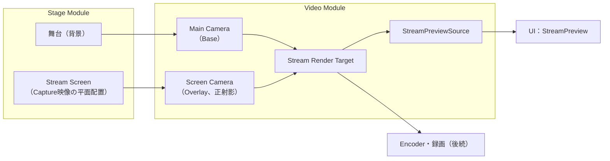

# Video 詳細設計

## 1. 目的

本書は、Video Moduleの詳細設計を定義する。Video Moduleは、Main Cameraと、Stageが決めた画面の内容から、配信用の映像（Stream Render Target）を作る。

対象は以下とする。

- Main Camera（Persistent Sceneにあり、アプリ全体で1つ、方式設計10.3）
- Stream Render Target（配信、録画、プレビューで共通の映像源、方式設計10.5、10.6）
- 配信画面に平面で置く映像の層（Stream Screen Layer）。Stageが中身を置く
- アプリ内プレビューへの映像と数値（`IStreamPreviewSource`、UI基盤詳細設計9.9）
- 映像のフレームレートの目標と計測

次は本書の対象外とし、後続の設計で扱う。

- Video Encoding、録画、配信（方式設計10.7〜10.10）
- アバター用の層（アバターの設計時に追加する。7.2）
- Camera Pointへの移動と切り替え（Stage Sceneの設計と合わせて扱う。方式設計10.4、11.5）
- Diagnostic Camera（方式設計5.17）
- 解像度とフレームレートを利用者が変える画面（配信設定の設計時）

関連する方式設計：

- 10.3 カメラ管理方式
- 10.5 映像生成方式
- 10.6 プレビュー表示方式
- 10.23 Capture映像のStage連携方式
- 15.5 映像リアルタイム性能

### 全体像



---

## 2. 責務

| 責務 | 担当 |
|---|---|
| Main Cameraの設定（描画先、描く層、背景色） | Video |
| Stream Render Targetの作成、作り直し、解放 | Video |
| 層ごとのカメラの重ね順（舞台、平面の映像、アバター） | Video |
| 平面の映像の層の座標系（配信画面の0〜1）を提供する | Video |
| 層に何を置くか（どのCapture映像を、どこに、どの順で） | Stage |
| 配置の保存と編集の受け付け | Stage（`IFrameSource`） |
| プレビューの表示 | UI（`StreamPreview`） |
| 映像のフレームレートの計測と診断 | Video |

---

## 3. Module境界

- VideoはCaptureを参照しない。Capture映像は、Stageが平面の映像の層へ置いたものとして描く。
- VideoはUIの公開Contract（`IStreamPreviewSource`）を実装する。UIはVideoを参照しない。
- StageはVideoの公開Contract（`IStreamOutput`、`IStreamScreenLayer`）を使う。VideoはStageを参照しない。
- Unityの`Camera`と`RenderTexture`はVideoの内部に閉じる。外へは`Texture`（読み取り用の映像）と、平面の映像の層の`Transform`だけを出す。

---

## 4. 主要ClassとInterface

| 名前 | 種類 | 概要 |
|---|---|---|
| `VideoService` | Class（`IApplicationService`） | Main CameraとStream Render Targetを用意し、毎Frameの計測を行う |
| `IStreamOutput` | Interface | 配信映像（`Video`）、大きさ、平面の映像の層 |
| `IStreamScreenLayer` | Interface | 平面の映像を置く場所。配信画面を0〜1で表す`Transform`と、描く層の番号 |
| `StreamPreviewSource` | Class（UIの`IStreamPreviewSource`） | プレビューへの映像と数値 |
| `VideoSettings` | Class | 解像度と目標フレームレート |
| `StreamFrameMeter` | Struct | 実際のフレームレートを数える（純粋） |
| `ScreenLayerMath` | Static Class | 正射影カメラの大きさと、0〜1の座標の変換（純粋関数） |

---

## 5. Public API

```csharp
public interface IStreamOutput
{
    IReadOnlyObservable<Texture> Video { get; }   // Stream Render Target。解像度が変わると別のTextureになる
    VideoSize Size { get; }                       // 配信映像の大きさ（既定1920×1080）
    IStreamScreenLayer Screens { get; }
}

public interface IStreamScreenLayer
{
    // 子のlocalPositionで、x：左0〜右1、y：上0〜下1が配信画面になる。zが小さいほど手前に描く。
    Transform Root { get; }
    int Layer { get; }                            // 子のGameObjectに設定するUnityの層
}

public readonly struct VideoSize
{
    public int Width { get; }
    public int Height { get; }
}
```

- `IStreamScreenLayer.Root`の子に置いた物は、Screen Cameraだけが描く。置く物の`layer`は`Layer`にする。
- 平面の映像の層は、舞台の上、アバターの下に描く（7.2）。

---

## 6. Data Model

### 6.1 VideoSettings

```csharp
public sealed class VideoSettings
{
    public int Width { get; set; } = 1920;
    public int Height { get; set; } = 1080;
    public int TargetFrameRate { get; set; } = 60;
    public Color BackgroundColor { get; set; }   // 舞台がないときの背景（既定は暗い紺）
}
```

- 保存しない（配信設定の設計時に決める。17章）。
- 解像度は16:9に限らない。プレビューと配置編集は、`Size`の縦横比に従う。

### 6.2 Stream Render Target

| 項目 | 値 | 理由 |
|---|---|---|
| 形式 | `ARGB32`、sRGB | 色空間がLinearのため。sRGBでないとプレビューが白っぽくなる（UI基盤の試作で確認） |
| 深度 | 24bit | 舞台とアバターの3D描画のため |
| MSAA | なし（初期） | 計測してから決める（17章） |
| 名前 | `StreamRenderTarget` | Frame Debugger等で見分けるため |

---

## 7. State / Lifecycle

### 7.1 VideoService

- Optional のApplication Serviceとし、Logging、性能計測の後に起動する。Persistent SceneのMain Cameraが必要なため、Compositionは`ApplicationBootstrap`が渡すMain Cameraがあるときだけ登録する。
- 起動時に、Stream Render Targetを作り、Main Cameraを設定し、Screen Cameraを作る。目標フレームレート（`Application.targetFrameRate`、VSyncはオフ）を設定する。
- 毎Frame、`IFrameLoop`で実際のフレームレートを数え、約1秒ごとにプレビューの数値を更新する。
- 終了時は、Main Cameraの描画先を外し、Screen CameraとStream Render Targetを破棄する。Main Camera自体はSceneの物なので破棄しない。

### 7.2 カメラの重ね順

UniversalRenderPipelineのCamera Stackで、層ごとに描く。

| 順 | カメラ | 種類 | 描く物 | 消去 |
|---|---|---|---|---|
| 1 | Main Camera | Base、透視投影 | 舞台（下の2つの層以外） | 背景色 |
| 2 | Screen Camera | Overlay、正射影 | 平面の映像の層（`StreamScreens`） | なし |
| 3 | Avatar Camera（後続） | Overlay、Main Cameraと同じ位置と画角 | アバターの層 | 深度だけ |

- 平面の映像はアバターの後ろに出す（利用者の決定、2026-10-17）。映像ごとに前後を選ぶ機能は後で足せるよう、層の順は表で管理する。
- Screen CameraはMain Cameraの子にしない。正射影で原点に置き、配信画面の範囲だけを描く。Main Cameraが動いても平面の映像は動かない。
- Unityの層`StreamScreens`をProject設定に追加する。
- Main CameraがStream Render Targetへ描くため、アプリのウィンドウへ描くカメラがなくなる。ウィンドウに描くカメラがないと、その上に描くUIが表示されない。そのため、何も描かずに消去だけするWindow Camera（描く層なし、黒で消去）を置く。

### 7.3 平面の映像の層の座標

- Screen Cameraは原点から+Zを向き、正射影の高さを1とする。幅は縦横比（例：16:9なら1.78）。
- `Root`は、左上が(0, 0)、右下が(1, 1)になるよう、位置と拡大率（xは縦横比、yは-1）を設定する（`ScreenLayerMath`、純粋関数）。
- 置く物は、`localPosition.z`で重なりを決める。Stageは重なり順の大きい映像ほど小さいzにする。

### 7.4 解像度の変更

- `VideoSettings`の解像度が変わったら、新しいStream Render Targetを作ってMain Cameraへ設定し、`Video`を新しいTextureにしてから古いものを解放する。プレビューは`Video`の変化で差し替える。
- 現在は起動時の値だけを使う（変更する画面は後続）。

---

## 8. 主要Sequence

### 8.1 起動からプレビューまで

1. `ApplicationBootstrap`がPersistent SceneのMain CameraをCompositionへ渡す。
2. `VideoService.InitializeAsync`：Stream Render Targetを作り、Main Cameraの`targetTexture`に設定する。描く層から`StreamScreens`を外し、背景色で消去する。
3. Screen Cameraを作り、Main CameraのCamera Stackへ加える。
4. `StageService`（Stage詳細設計）が`IStreamScreenLayer.Root`の下へ平面の映像を置く。
5. UIの`StreamPreview`が`StreamPreviewSource.Video`を表示する。配信と同じTextureなので、見えている物がそのまま配信される。

---

## 9. Thread / async

- カメラ、Render Target、数値の更新は、すべてMain Threadで行う。
- 描画はUnityの描画Loopに任せ、Videoは毎Frameの描画を呼ばない。

---

## 10. 設定

6.1の`VideoSettings`を`VideoService`の生成時に渡す。保存先と変更の画面は後続で決める。

---

## 11. ログ・診断

- 起動時に、解像度、目標フレームレート、色空間、Stream Render Targetの形式をInformationで記録する。
- 性能計測：

| Metric | 種類 | 内容 |
|---|---|---|
| `Video/FrameInterval` | Timer | Frameの間隔（実際のフレームレートの元） |
| `Video/Frames` | Counter | 描いたFrame数 |

- プレビューの数値（`PreviewStats`）：実際のフレームレート（約1秒ごと）、目標フレームレート、解像度。ビットレートはEncoderができるまで`null`。

---

## 12. エラー処理・復旧

| 事象 | 扱い |
|---|---|
| Main Cameraが渡されない | VideoServiceを登録しない。プレビューは「映像がありません」と表示する |
| Stream Render Targetを作れない | 起動に失敗したOptional Serviceとして記録する。他の機能は止めない |
| Main Cameraが破棄された | 次のFrameで検出し、Errorを記録してプレビューの映像を外す |

---

## 13. セキュリティとプライバシー

- 配信映像はProcessの外へ出さない（Encoderができるまで）。プレビューはアプリ内だけで表示する。
- Diagnostic Camera等の開発用の映像を、Stream Render Targetへ描かない（方式設計5.18）。

---

## 14. テスト方針

| 種類 | 対象 |
|---|---|
| EditMode | `ScreenLayerMath`（0〜1の座標、縦横比）、`StreamFrameMeter`（純粋関数） |
| PlayMode | 平面の映像の層に置いた色付きの板が、Stream Render Targetの正しい位置に描かれること（画素を読み戻す）。Main Cameraが背景色で消去すること |
| PlayMode | 終了時に描画先が外れ、作った物が破棄されること |

---

## 15. 性能（方式設計15.5）

- Overlayカメラ1台分の描画が増える。平面の映像は板が数枚のため軽い。
- Stream Render Targetは1920×1080で約8MB（色）＋深度。
- フレームレートは`Video/FrameInterval`で計測する。目標を下回る状態はプレビューの表示（警告）で分かる。

---

## 16. Directory / Namespace

```text
Assets/VirtualVessel/Video/
├─ Runtime/                         VirtualVessel.Video
│  ├─ IStreamOutput.cs              IStreamOutput, IStreamScreenLayer, VideoSize
│  ├─ VideoSettings.cs
│  ├─ VideoService.cs
│  ├─ StreamPreviewSource.cs
│  ├─ StreamFrameMeter.cs
│  └─ ScreenLayerMath.cs
└─ Tests/
   ├─ EditMode/
   └─ PlayMode/
```

参照：Core、Diagnostics、UI（`IStreamPreviewSource`）、URP。

---

## 17. 未決事項

| 項目 | 対応予定 |
|---|---|
| Encoder、録画、配信 | 各設計時 |
| 解像度とフレームレートの変更画面と保存 | 配信設定の設計時 |
| アバター用の層 | アバターの設計時 |
| MSAA、HDR | 計測してから |
| 映像ごとにアバターの前後を選ぶ | 要望が出た時点で（7.2） |

---

## 18. 実装の順序

Stageの詳細設計の18章にまとめる。
