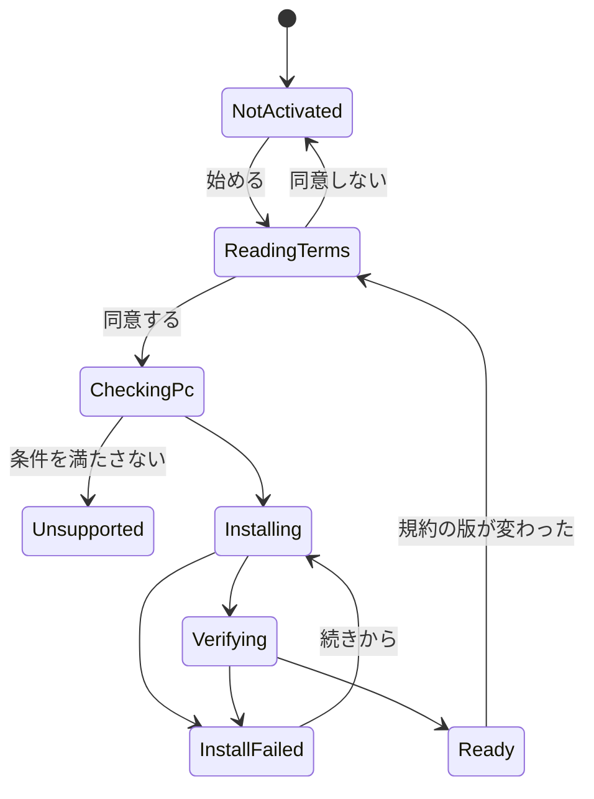

# Voice Lab詳細設計

## 1. 目的

利用者が、自分の理想の声を作って登録できるようにする（方式設計13章）。コマンドやPythonを見せず、アプリの中の操作で終える。

目玉は、利用者が自分好みの声を作り出せることである（利用者の方針、2026-11-03）。一度の指定で理想に当てるのではなく、近い声を選び、少しずつ寄せ、自分の声で試して決められるようにする（8.3）。

- 声を作る機能は、利用者がアクティベーションするまで動かない（利用者の決定、2026-11-01）。
- アクティベーションのときに学習環境を構築する。インターネット接続を前提とする。
- 利用規約に必要な情報と免責事項を必ず表示する（利用者の決定、2026-11-01）。
- 声の変換は要求スペックが高い（GPUの速さとメモリー）。アクティベーションの前と、配布のページで必ず知らせる（利用者の指摘、2026-11-02）。必要なスペックの値は未定である（17章）。

この設計に含めないもの：リアルタイムの変換（[Voice詳細設計](voice.md)）、Processの起動と監視（[External Services詳細設計](external-services.md)）。

## 2. 責務

| 責務 | 担当 |
|---|---|
| 規約の表示と同意の記録 | VoiceLab（`VoiceTerms`） |
| 学習環境の構築、確認、削除 | VoiceLab（`VoiceComponentInstaller`） |
| 学習用の音声の管理 | VoiceLab（`DatasetStore`） |
| 学習の実行と状態 | VoiceLab（`TrainingManager`、`RvcAdapter`） |
| 声の登録 | VoiceLab（`VoiceModelRegistrar`） |
| Processの実行 | ExternalServices |
| 登録された声の利用 | Voice |

## 3. Moduleの境界

- `VirtualVessel.VoiceLab`はExternalServicesの`IExternalProcessRunner`を通してだけProcessを動かす（方式設計4.4）。
- RVCとVoxCPM2の本体は変更しない（方式設計13.3）。本システムのコードは`services/`のAdapterに置く。
- Unityが知るのはAdapterの入出力だけで、RVCのフォルダー構成やログの形式は知らない。
- 配信の経路はVoiceLabに依存しない。

## 4. 主なClassとInterface

| Class | 種類 | 役割 |
|---|---|---|
| `IVoiceLab` | Interface（UI） | UIが使う：アクティベーション、音声、学習、登録 |
| `VoiceLabService` | Class | Application Service |
| `VoiceTerms` | Class | 規約の版、本文の場所、同意の確認 |
| `VoiceComponentInstaller` | Class | 構築の手順を進める |
| `VoiceComponentManifest` | Class | 取得するものの一覧、版、ハッシュ |
| `DatasetStore` | Class | 学習用の音声の取り込みと確認 |
| `TrainingManager` | Class | Training Runの状態 |
| `RvcAdapter` | Class | Python側のAdapterとのやり取り |
| `VoiceModelRegistrar` | Class | 学習結果を声として登録する |
| `VoiceDesigner` | Class | 声を設計する流れ（8.3）：土台の候補、声色の試聴、学習用の音声 |

Python側：

| ファイル | 役割 |
|---|---|
| `services/voice-lab/train.py` | 前処理、特徴量、学習をまとめて実行し、進捗をJSON Linesで出す（8.5） |
| `services/voice-lab/export_voice.py` | 学習結果をひな形へ書き込む（8.4） |
| `services/voice-lab/generate.py` | VoxCPM2で音声を作る：土台の候補、学習用の音声（8.3） |
| `services/voice-lab/timbre.py` | WORLDで声色を変える（8.3.2）。試聴と学習用の音声の両方に同じ値を使う |

## 5. 公開API

```csharp
public interface IVoiceLab
{
    IReadOnlyObservable<VoiceLabState> State { get; }
    IReadOnlyObservable<InstallProgress> Install { get; }
    VoiceTermsDocument Terms { get; }
    Task ActivateAsync(VoiceTermsAgreement agreement, CancellationToken cancellationToken);
    Task<DatasetInfo> ImportDatasetAsync(IReadOnlyList<string> files, CancellationToken cancellationToken);
    Task<TrainingRunInfo> TrainAsync(TrainingRequest request, CancellationToken cancellationToken);
    Task<VoiceModelInfo> RegisterAsync(string runId, string name, CancellationToken cancellationToken);

    // 声を設計する（8.3）
    Task<IReadOnlyList<VoiceCandidate>> MakeCandidatesAsync(VoiceDescription description, int count, CancellationToken cancellationToken);
    Task<AudioClipInfo> PreviewTimbreAsync(string candidateId, TimbreSettings timbre, CancellationToken cancellationToken);
    Task<TrainingRunInfo> BuildVoiceAsync(string candidateId, TimbreSettings timbre, CancellationToken cancellationToken);
}
```

`TimbreSettings`は高さ（半音）、年齢（響きの倍率）、明るさ、息っぽさの4つの数値で、どれも0（変えない）を既定とする。

## 6. Data Model

### 6.1 アクティベーション

`Config/voice-activation.json`に保存する。

| 項目 | 意味 |
|---|---|
| `schemaVersion` | 形式の版 |
| `termsVersion` | 同意した規約の版 |
| `agreedAtUtc` | 同意した日時 |
| `componentsVersion` | 構築した環境の版 |
| `state` | `NotStarted`、`Installing`、`Ready`、`Failed` |

### 6.2 取得するものの一覧

アプリに同梱する`voice-components.json`（アプリの版ごとに固定、方式設計13.5）。

```json
{
  "schemaVersion": 1,
  "version": "1",
  "uv": { "url": "...", "sha256": "..." },
  "python": "3.12.2",
  "lock": "services/voice-lab/uv.lock",
  "rvc": { "repository": "...", "commit": "81eed5e8f68b...", "sha256": "..." },
  "files": [
    { "id": "rmvpe.pt", "url": "...", "sha256": "...", "license": "MIT" }
  ]
}
```

### 6.3 Training Run

方式設計13.14のとおり`VoiceLab/TrainingRuns/<RunId>/`に置き、`run.json`に状態を持つ。

**最初の版はSQLiteを使わない。** 一覧は`run.json`を読めば作れる。比較の画面を作るときに、方式設計13.12のSQLiteを足す。

## 7. 状態とライフサイクル



Training Runの状態は方式設計13.15のとおり。

## 8. 主な流れ

### 8.1 アクティベーション

```text
Voice Labを開く
  ↓ 説明：できること、容量（約8 GB。VoxCPM2は別に必要）、時間、NVIDIAのGPUが必要、要求スペックが高いこと
規約を表示する（8.2）→ 同意する
  ↓
PCの確認：GPU、ドライバー、空き容量、接続
  ↓
取得（続きから再開できる。すべてハッシュを確認する）
  1. uv
  2. Python
  3. 依存パッケージ（lockのハッシュどおり）
  4. RVC（固定のcommit）
  5. モデル、ひな形
  ↓
確認：短い音声で前処理と1エポックの学習を実際に動かす
  ↓
完了
```

実測（2026-11-01、RTX 4070の開発PC）：取得と展開に約1時間。容量は環境と学習用のモデルで約7 GB、Runtimeの共有モデルとひな形で約1 GBの合計約8 GB。uvのキャッシュが別に約6 GBあり、構築の途中は約14 GB要る。キャッシュは構築のあとに消す。回線か、ファイルの検査かなど、時間の内訳は未測定である。VoxCPM2の環境は依存を絞っていない。

時間がかかるので、説明の画面で目安を示し、中断しても再開できることを伝える。

取得先は配布元とする。本システムのひな形とHuBERT、RMVPEの`.sentis`は、本プロジェクトのGitHub Releaseに置く。

配布元が変わったり消えたりしても新規の利用者が使えるよう、次の対策をとる。

- MITとApache-2.0のモデルとRVCのソースは、同じGitHub Releaseに控えを置く。配布元に無いときは控えから取得し、どちらも同じハッシュで確かめる。表記は控えにも残す。
- PyPIのパッケージと、PyTorchとCUDAは控えを置かない。消える可能性が低く、後者は再配布を避けるためである。
- GitHub Actionsで定期的に、すべての取得先に届き、ハッシュが合うことを確かめる。
- 取得先の一覧はアプリに同梱するので、直すにはアプリの更新が要る。PyTorchの配布元が古い版を消した場合は、更新するまで新規のアクティベーションができない。配信と構築済みの環境には影響しない。

進み具合は「環境を準備しています」のように表示し、Python、pipなどの言葉は通常の画面に出さない（方式設計4.27）。

### 8.2 利用規約と免責事項

[決定記録](../decisions/voice-conversion.md)の要件による。

- 本文はアプリに同梱する。日本語と英語を持ち、版を付ける。
- アクティベーションの前に全文を表示し、同意しないと次へ進めない。
- 同意した版と日時を保存する。
- 版が変わったら、声を作る操作の前に再び同意を求める。登録済みの声での配信は止めない。
- 設定の「クレジットとライセンス」から、いつでも同じ内容を読める。
- 録音を取り込むときに、本人の声か権利を持つ声であることの確認を表示する。

### 8.3 声を作る

第1段階（自分の音声から）：

```text
音声ファイルを取り込む → 確認（長さ、無音、音割れ） → 学習 → 試聴 → 登録
```

第2段階（理想の声を設計する）。実験（決定記録、2026-11-03「声を設計する実験」）をもとにした流れ：

```text
1. 土台を選ぶ     ：声の雰囲気をつまみと文章で指定 → 候補を何個も作る → 聞いて選ぶ
2. 声色を寄せる   ：高さ、年齢、明るさ、息っぽさのつまみ → 土台の声を加工して、その場で試聴 → 繰り返す
3. 作る           ：土台の声で学習用の音声を作る → 同じ加工をかける → 学習（1回）
4. 自分の声で試す ：アプリのリアルタイムの変換で、自分の録音かマイクの声を変換して聞く
5. 登録する       ：気に入らなければ2へ戻る
```

既定の学習は150エポック。RTX 4070で7分の音声に約10分かかった。3は1つの声で約20分（学習用の音声7.5分の生成に約7分、加工に約2分、学習に約11分。2026-11-03の実測）。

#### 8.3.1 土台を選ぶ

- 声の雰囲気は、つまみ（若さ、高さ、明るさ、柔らかさ、息っぽさ、元気さ、かわいさ、抑揚、速さ、自然さ）と自由な文章から、VoxCPM2への指示文を組み立てる。組み立て方はVCBMの`VoicePromptBuilder`を使う。
- 同じ指示でも乱数で声が大きく変わる（同じ指示で268 Hzと406 Hz）。つまみだけでは理想に届かないので、1回に複数（6個程度）の候補を作り、「もっと作る」で増やせるようにする。
- 候補は聞くだけでなく数値でも比べられるようにする（利用者の要望、2026-11-03）：声の高さ（中央値）と高さの幅（5〜95%）をHzで示し、共通の目盛りの上に幅を描く。高さの順に並べ替えられる。
- 画面の段階は「STEP 1」から「STEP 5」の番号で示し、次へ進むボタンにも行き先の番号を付ける（利用者の要望、2026-11-03）。
- 言葉の指示で寄せる場合は、選んだ土台だけを手本にする。生成した声を手本にして重ねると、声が枯れていく。
- 実在の人の声のサンプルから土台を作る方法はとらない（利用者の判断、2026-11-03。権利の問題がない声の当てがない）。

#### 8.3.2 声色を寄せる

- WORLD（pyworld、MIT。WORLD本体は修正BSD）で、土台の声を高さ、響き、息の成分に分けて動かす。同じ値なら同じ結果になり、試聴は数秒で終わる。
- Praat（parselmouth）はGPLなので使わない。
- つまみと実験の結果：

| つまみ | 加工 | 結果 |
|---|---|---|
| 高さ | 高さを半音で動かす | +4半音でも同じ人に聞こえる |
| 年齢 | 響きを周波数の方向に伸ばす | ×1.10は「同じ人と言えば同じ人」（利用者） |
| 明るさ | 響きの傾き | 未検証 |
| 息っぽさ | 声の部分の非周期成分 | 測った数値では違いが見えない。耳での確認が要る |

- 抑揚と話す速さのつまみは置かない。変換の後の抑揚と速さは話す本人から来る（学習用の音声で変えても変換後に残らない）。抑揚を変換で大きくすると機械っぽくなる（利用者、2026-11-03）。
- 加工した声色は、学習とリアルタイムでない変換を通っても残った（決定記録）。

#### 8.3.3 作る

- 学習用の音声は、選んだ土台を手本にしたVoxCPM2の声のコピーで作る（指示文は付けない）。そのあと8.3.2と同じ値で加工する。
- 文の選び方：5つの母音のすべて、伸ばした母音、高めの声を含める。伸ばした「う」が「あ」に寄る問題（Voice詳細設計）は、学習用の音声の母音の不足も一因かもしれない。**未検証の仮説**である。
- 土台の指示文、乱数、声色の値をTraining Runに残し、作り直せるようにする（6.3）。

#### 8.3.4 自分の声で試す

- アプリのリアルタイムの変換（Voice詳細設計の窓、つなぎ目の重ね、直前の声、ノイズ除去）で試す。ファイル全体を一度に変換する上流の変換は窓の問題を隠し、作った声を高く評価してしまう。伸ばした「う」と「え」は、上流の変換では正しく、リアルタイムでは崩れた。
- 試す音声は、利用者の録音（WAV、M4A、MP3。Audio詳細設計5.4）か、マイクの声とする。
- 変換の高さは自動で合わせる：声の登録のときに声の高さの中央値を残し、利用者の声の高さとの差から移す量を決める。Voice側の受け取り方はVoice詳細設計で決める（17章）。

### 8.4 登録（Editorなしで`.sentis`を作る）

Unity EditorのONNX変換は配布したアプリでは使えない。学習した重みをひな形へ書き込む（検証の結果は決定記録を参照）。

```text
学習結果（.pth）
  ↓ export_voice.py
ONNXへ書き出す（話者ベクトルは入力、.spkへ分ける）
  ↓
ひな形の.sentisの、配置表の位置へ重みを書く
  ↓
検査：大きさ、ハッシュ、短い音声で実際に変換する
  ↓
VoiceModels/<VoiceModelId>/へ置く
```

- ひな形と配置表は、開発者がEditorで作り、`com.unity.ai.inference`の版と対にする。
- パッケージを更新したら、作り直してSHA-256の比較をやり直す。
- アプリの更新で形式が変わる場合に備え、学習の成果物（`.pth`）を残す。残っていれば登録をやり直せる。

### 8.5 Python側の入出力

Unityは、`services/voice-lab`の各スクリプトを、ExternalServicesの`IExternalProcessRunner`で1回ずつ実行する（方式設計4.4）。環境は1つで、RVCの学習とVoxCPM2の生成の両方に使う（決定記録、2026-11-03）。

```text
python -I <スクリプト>.py <操作> <依頼のJSONファイル>
```

- 依頼はJSONファイルで渡す。パスや文章をコマンドラインに並べないので、空白や日本語の引用の問題が起きない。
- 進み具合と結果は、標準出力にJSON Linesで1行ずつ出す。標準エラーはログで、Training Runのフォルダーへ保存する（13章）。
- 終了コード：0は成功、1は失敗（直前に`error`の行を出す）、2は依頼の誤り。
- 取り消しは、Runnerがプロセスごと止める。出力は一時ファイルに書いてから名前を変えるので、途中で止めても作りかけのファイルは残らない。

| 行の`type` | 中身 |
|---|---|
| `progress` | `stage`（段階の名前）、`done`、`total` |
| `result` | 操作ごとの結果（下の表） |
| `error` | `code`（`bad_request`、`out_of_memory`、`missing_file`、`failed`）と、開発者向けの`message` |

| スクリプトと操作 | 依頼の主な項目 | 結果 |
|---|---|---|
| `generate.py candidates` | 雰囲気（つまみの値と文章）、個数、最初の乱数、モデルの場所、出力先 | 候補ごとの音声、乱数、声の高さの中央値と幅（5〜95%） |
| `generate.py speech` | 手本の音声、乱数の始まり、モデルの場所、出力先 | 学習用の音声の一覧と合計の長さ |
| `timbre.py preview` | 元の音声、声色の値、出力先 | 加工した音声、声の高さの中央値 |
| `timbre.py batch` | 元の音声のフォルダー、声色の値、出力先 | 加工した音声の一覧 |
| `train.py run` | RVCの場所、学習用の音声のフォルダー、作業フォルダー、エポック数 | 学習した重み（`.pth`） |
| `export_voice.py run` | 重み、ひな形と配置表、RVCの場所、出力先 | 声の`.sentis`、`.spk`、声の情報（`voice.json`：声の高さの中央値ほか） |

- 声色の値は、高さ（半音）、年齢、明るさ、息っぽさの段階（-6〜+6、0は変えない）とする。年齢の1段は響きの2.5%、明るさの1段は1 kHzを境に1オクターブあたり1.5 dBの傾き、息っぽさの1段は非周期成分の指数を2^(1/5)倍にする。年齢の+4（響き×1.10）は実験で確かめた。明るさと息っぽさの効きは未検証である（17章）。
- 学習用の音声の文は、本システムが用意する（`voicelab/corpus.py`）。5つの母音、伸ばした音、高めの声になりやすい文を含める（8.3.3の未検証の仮説）。
- RVCの学習の進み具合は、RVCのログの`====>`で始まる行から読む。ログの文言は言語で変わるが、この形は変わらない。
- RVCの学習は、RVCのフォルダーの`logs/<名前>`に途中のファイルを作る（RVCは変更しない）。重みを作業フォルダーへ写したあと、そのフォルダーを消す。

## 9. Threadと非同期

インストールと学習は別のProcessで動く。Unityの側はメインスレッドを止めず、進捗を受け取って`IMainThreadDispatcher`でUIへ渡す。すべて`CancellationToken`で止められる。

学習中はGPUのメモリーを使うので、配信中は学習を始められないようにする。

## 10. 設定

通常の画面の項目は、学習の長さ（標準、長め）だけとする。細かい値はDeveloper Modeで見せる。

## 11. 保存

| 内容 | 場所 |
|---|---|
| 学習環境 | `%LOCALAPPDATA%\VirtualVesselStudio\External\VoiceLab\<版>\` |
| 同意と状態 | `Config/voice-activation.json` |
| 音声、Training Run | Data Rootの`VoiceLab/` |
| 登録した声 | Data Rootの`VoiceModels/` |

学習環境は大きいので、Data Rootに入れず、バックアップの対象にしない。削除しても、登録した声は動く。画面から削除できるようにする。

## 12. エラーと回復

| 起きたこと | 動作 | 利用者への表示 |
|---|---|---|
| 接続が切れた | 取得の途中から再開できる | 接続を確認して、もう一度お試しください |
| ハッシュが違う | そのファイルを捨てる | 取得したファイルに問題がありました |
| 空き容量が足りない | 始めない | 空き容量が○GB必要です |
| 学習の失敗 | Runを`Failed`で残す | 学習を完了できませんでした |
| GPUのメモリー不足 | Runを`Failed`で残す | ほかのアプリを閉じて、もう一度お試しください |
| 取り消し | Runを`Cancelled`で残す | |

Voice Labの失敗は、配信に影響させない（CLAUDE.md 21章）。

## 13. ログと診断

- 学習のstdoutとstderrをRunのフォルダーへ保存する（方式設計13.16）。
- 利用者の音声の内容は記録しない。音声は外部へ送らない。
- 診断画面に、環境の版、Pythonの版、CUDAの版、RunId、Exit Codeを表示する（方式設計13.24）。

## 14. Testの方針

| 種類 | 内容 |
|---|---|
| EditMode | 規約の判定、`voice-components.json`、状態の変化、進捗の解釈、ハッシュの確認 |
| Python | Adapterの単体テスト、配置表の適用 |
| 手動（重い） | 空のPCでのアクティベーション、再開、取り消し |
| 版の更新時 | ひな形と配置表のSHA-256の比較 |

実際の取得と学習はCIでは動かさない。Self-hosted Runnerで手動で実行する。

## 15. 性能

- 配信中は動かないので、リアルタイムの制約はない。
- メインスレッドを止めない。
- 容量と時間の目安をアクティベーションの前に示す。

## 16. Folder / Namespace

```text
Assets/VirtualVessel/VoiceLab/Runtime/
├─ Activation/   VoiceTerms、VoiceComponentInstaller、VoiceComponentManifest
├─ Dataset/      DatasetStore
├─ Training/     TrainingManager、RvcAdapter
├─ Registration/ VoiceModelRegistrar
└─ Design/       VoiceDesigner

services/voice-lab/
├─ pyproject.toml、uv.lock
├─ train.py、export_voice.py、generate.py、timbre.py   入口（8.5）
├─ voicelab/      共通の処理：入出力、指示文、声色、声の高さ、文、生成器の書き出し、重みの書き込み
├─ parselmouth.py   読み込みだけを満たす空のモジュール（決定記録）
└─ tests/
```

## 17. 段階と未解決

段階：

1. ExternalServicesとアクティベーション（規約、構築、確認）
2. 音声の取り込み、学習、登録
3. VoxCPM2で声を設計する
4. 評価と比較、学習履歴のSQLite

未解決：

- VoxCPM2の依存を絞る。`kaldiio`を外す必要がある（決定記録）。
- 本当に初めてのPCでの確認。開発PCにはドライバーなどが入っている。
- VoxCPM2の必要なGPUメモリーと、RVCの学習との切り替え。
- 同意の画面の文面。公開前に法律の専門家の確認を受ける。
- 声の変換に必要なGPUとメモリーの値。開発PCのほかでも測って決める。
- 声を設計する流れ（8.3）：明るさと息っぽさのつまみの効き、年齢の倍率の範囲、学習用の音声の母音の仮説を確かめる。上の「及第点」は上流の変換での評価で、リアルタイムの変換では未確認である。
- 変換の高さの自動合わせ：声の登録に高さの中央値を持たせる形式と、Voice側での使い方（Voice詳細設計の担当）。

利用者が承認したこと（2026-11-01）：

1. 環境は利用者のPCでuvとlockから構築する。方式設計13.4、13.6、13.7、13.8、4章を更新した。
2. 学習はNVIDIAのGPUだけとする。声の利用はほかのGPUでも動く見込みだが、未検証である。
3. SQLiteは比較の画面を作るまで先送りする（6.3）。方式設計13.12に記した。
