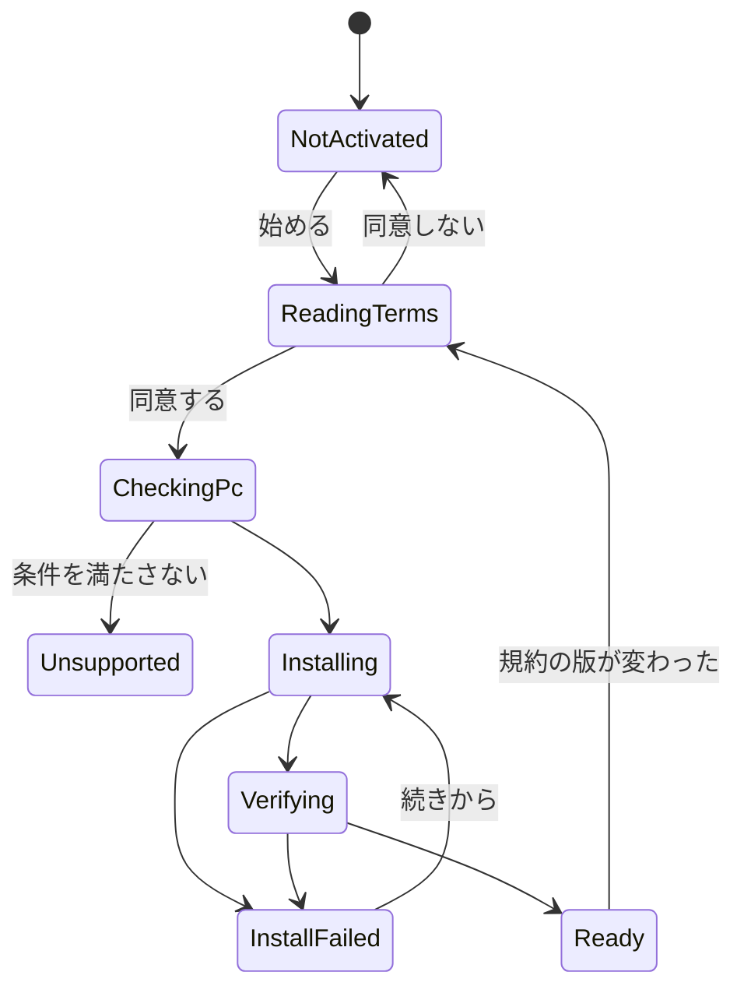

# Voice Lab詳細設計

## 1. 目的

利用者が、自分の理想の声を作って登録できるようにする（方式設計13章）。コマンドやPythonを見せず、アプリの中の操作で終える。

目玉は、利用者が自分好みの声を作り出せることである（利用者の方針、2026-11-03）。一度の指定で理想に当てるのではなく、近い声を選び、少しずつ寄せ、自分の声で試して決められるようにする（8.3）。

- 声を作る機能は、利用者がアクティベーションするまで動かない（利用者の決定、2026-11-01）。
- アクティベーションのときに学習環境を構築する。インターネット接続を前提とする。
- 利用規約に必要な情報と免責事項を必ず表示する（利用者の決定、2026-11-01）。
- 声の変換は要求スペックが高い（GPUの速さとメモリー）。アクティベーションの前と、配布のページで必ず知らせる（利用者の指摘、2026-11-02）。必要なスペックの値は未定である（17章）。

この設計に含めないもの：リアルタイムの変換（[Voice詳細設計](voice.md)）、Processの起動と監視（[External Services詳細設計](external-services.md)）。

## 2. 責務

| 責務 | 担当 |
|---|---|
| 規約の表示と同意の記録 | VoiceLab（`VoiceTerms`） |
| 学習環境の構築、確認、削除 | VoiceLab（`VoiceComponentInstaller`） |
| 学習用の音声の管理 | VoiceLab（`DatasetStore`） |
| 学習の実行と状態 | VoiceLab（`VoiceDesigner`、`TrainingRunStore`、`PythonScripts`） |
| 声の登録（Voiceへ渡す） | VoiceLab（`VoiceModelRegistrar`） |
| 登録した声の記録 | Voice（`IVoiceModelRepository`。Voice詳細設計6.1） |
| Processの実行 | ExternalServices |
| 登録された声の利用 | Voice |

## 3. Moduleの境界

- `VirtualVessel.VoiceLab`はExternalServicesの`IExternalProcessRunner`を通してだけProcessを動かす（方式設計4.4）。
- RVCとVoxCPM2の本体は変更しない（方式設計13.3）。本システムのコードは`services/`のAdapterに置く。
- Unityが知るのはAdapterの入出力だけで、RVCのフォルダー構成やログの形式は知らない。
- 配信の経路はVoiceLabに依存しない。
- 登録した声はVoiceが持つ（利用者の決定、2026-11-08）。VoiceLabはVoiceの`IVoiceModelRepository`を通して、声を渡し、名前を変え、消す。VoiceはVoiceLabを参照しない。

## 4. 主なClassとInterface

| Class | 種類 | 役割 |
|---|---|---|
| `IVoiceLab` | Interface（UI） | 画面が使う：候補、声色の試聴、作成、登録（5）。アクティベーションは後で |
| `VoiceLabService` | Class | Application Service |
| `VoiceTerms` | Class | 規約の版、本文の場所、同意の確認 |
| `VoiceComponentInstaller` | Class | 構築の手順を進める |
| `VoiceComponentManifest` | Class | 取得するものの一覧、版、ハッシュ |
| `DatasetStore` | Class | 学習用の音声の取り込みと確認 |
| `TrainingRunStore` | Class | Training Runのフォルダーと`run.json`（6.3） |
| `PythonScripts` | Class | Python側のスクリプトとのやり取り（8.5）。スクリプトの名前と決まりごとを知るのはここだけ |
| `VoiceLabEnvironment` | Class | 学習環境の場所。アクティベーションができるまでは開発者が指定する（6.4） |
| `VoiceModelRegistrar` | Class | 学習結果を、作り方（`design.json`）と一緒にVoiceへ渡す |
| `VoiceDesigner` | Class | 声を設計する流れ（8.3）：土台の候補、声色の試聴、学習用の音声 |

Python側：

| ファイル | 役割 |
|---|---|
| `services/voice-lab/train.py` | 前処理、特徴量、学習をまとめて実行し、進捗をJSON Linesで出す（8.5） |
| `services/voice-lab/export_voice.py` | 学習結果をひな形へ書き込む（8.4） |
| `services/voice-lab/generate.py` | VoxCPM2で音声を作る：土台の候補、学習用の音声（8.3） |
| `services/voice-lab/timbre.py` | WORLDで声色を変える（8.3.2）。試聴と学習用の音声の両方に同じ値を使う |

## 5. 公開API

`IVoiceLab`はUIのモジュール（`VirtualVessel.UI.VoiceLab`）で宣言し、`VoiceLabService`が実装する。画面はVoice Labのクラスに依存しない。型は画面のためのもので、8.5の要求と結果の型はVoice Labの中に留める。

```csharp
public interface IVoiceLab
{
    VoiceLabShelf Shelf { get; }                 // STEP 1の言葉と例（8.3.1）。準備がないときはnull
    string SampleFile(string language, string name);           // 見本のファイル。まだ作っていなければnull
    Task MakeSamplesAsync(CancellationToken cancellationToken);  // このPCで見本を作る（8.3.1）
    VoiceLabMaking SamplesProgress { get; }
    VoiceLabAvailability Availability { get; }   // Ready、または学習の環境がないときNotSetUp（6.4）

    // 声を設計する（8.3）
    Task<IReadOnlyList<VoiceLabCandidate>> MakeCandidatesAsync(VoiceLabRequest request, int count, VoiceLabCandidate near, CancellationToken cancellationToken);  // near：null、または近くに作る元の候補（8.3.1）
    Task<VoiceLabPreview> PreviewAsync(VoiceLabCandidate candidate, VoiceLabTimbre timbre, CancellationToken cancellationToken);
    Task<VoiceLabBuild> BuildAsync(VoiceLabCandidate candidate, VoiceLabTimbre timbre, VoiceLabTrainingLength length, CancellationToken cancellationToken);  // 長さ：8.3.3
    VoiceLabMaking CandidatesProgress { get; }    // 候補をいくつ作ったか。モデルの読み込み中は総数なし
    VoiceLabBuildProgress BuildProgress { get; }  // 作成中の状態と割合。画面が必要なだけ読む
    void CancelBuild();                           // 作成を止める。配信や録画を始めるとき（方式設計14.26）
    CrudResult<string> Register(string runId, string name);   // 登録した声のID。すぐに使うため

    CrudResult<VoiceLabRemake> Remake(string runId);             // 作り直すための、Runの言葉、土台、声色（8.6）
}
```

`IVoiceLabLibrary`（これもUIモジュール）は作ったもので、「作った声」のタブが使う。学習の環境がなくても使えるので、別のインターフェイスにする。`VoiceLabLibrary`がリポジトリの上で実装する（8.6）。

```csharp
public interface IVoiceLabLibrary
{
    CrudResult<IReadOnlyList<VoiceLabRunRecord>> ListRuns();     // 新しい順
    CrudResult<IReadOnlyList<VoiceLabVoiceRecord>> ListVoices(); // 新しい順
    CrudResult SetComment(string runId, string comment);
    CrudResult RenameVoice(string voiceId, string name);
    CrudResult DeleteRun(string runId);                    // 作成中のRunは断る
    CrudResult DeleteVoice(string voiceId);
}
```

- `VoiceLabRequest`は棚の言葉のIDと、ユーザーの文章を持つ。`VoiceLabShelf`は棚のグループ、言葉（それぞれの枠と、枠の既定か）、例を持ち、言葉を押したときの変化を決める。`VoiceLabCandidate`は再生用の音声、声の高さ（中央値と5〜95%の範囲、Hz）、作ったときの指示文を持つ。指示文は折りたたんで見せる（方式設計14.14）。seedはVoice Labの中に留める。
- `VoiceLabTimbre`は高さ（半音）、年齢（響きの倍率）、明るさ、息っぽさ（-6から+6）と、やわらかさ（0から+6）の5つの段階で、どれも0（変えない）を既定とする。`run.json`は5つとも残す。やわらかさのない`run.json`は0で作ったものである。範囲はVoice Lab側で丸める。
- ユーザーに伝えるべき失敗は`VoiceLabFailedException`を投げる。メッセージは開発者向け。取り消しは`OperationCanceledException`を投げる。作成だけは、失敗と取り消しを`VoiceLabBuild.State`で返し、GPUのメモリー不足を`OutOfMemory`で示す。
- どのメソッドもメインスレッドを止めない。
- `Register`はファイルをコピーするので、画面はメインスレッドの外から呼ぶ。
- アクティベーションと規約（8.1、8.2）、自分の録音の取り込み（8.3の第1段階）は、それぞれの段階（17）で加える。

## 6. Data Model

### 6.1 アクティベーション

`Config/voice-activation.json`に保存する。

| 項目 | 意味 |
|---|---|
| `schemaVersion` | 形式の版 |
| `termsVersion` | 同意した規約の版 |
| `agreedAtUtc` | 同意した日時 |
| `componentsVersion` | 構築して使っている環境の版 |
| `installingVersion` | 構築している版。止めたか失敗したときも残り、次はその続きから進む |
| `state` | `NotStarted`、`Installing`、`Ready`、`Failed` |

### 6.2 取得するものの一覧

アプリに同梱する`voice-components.json`（アプリの版ごとに固定、方式設計13.5）。

```json
{
  "schemaVersion": 1,
  "version": "0.1",
  "python": "3.12.2",
  "lock": "uv.lock",
  "components": [
    {
      "id": "rvc",
      "url": "https://github.com/RVC-Project/.../archive/81eed5e8f68b....zip",
      "sha256": "c0427564...",
      "size": 821646,
      "license": "MIT",
      "place": "environment",
      "target": "rvc",
      "extract": "zip",
      "strip": 1
    }
  ]
}
```

`services/voice-lab/voice-components.json`に置き、スクリプトと一緒にアプリに同梱する。`tools/voice/voice_components.py`が、`tools/voice/voice-components.sources.json`（取得元、ライセンス、置き場所）と、開発PCで確かめたファイルそのものから作る。大きさとハッシュは、確かめたファイルの値である。`--release`を付けると、GitHub Releaseに置くファイルを1つのフォルダーに集める（利用者が公開する）。

- `place`：`environment`は学習環境の版のフォルダー（`<版>/`）に、`sharedModels`はData Rootの`VoiceModels/Shared/1/`に置く。配信が使うHuBERTとRMVPEの`.sentis`は後者なので、学習環境を削除しても配信は動く。
- `target`：置き場所の中の相対パス。`extract`が`zip`なら、展開するフォルダーである。`strip`は、zipの中のパスから先頭のフォルダーを外す数（GitHubのアーカイブの最上位のフォルダー）。
- `url`：取得元。他者のファイルは配布元だけを指し、本プロジェクトは控えを置かない（8.1）。本プロジェクトが作ったファイル（ひな形、共有のモデル）は、本プロジェクトのGitHub Releaseを指す。
- アプリは読むときに確かめる（`VoiceComponentManifest`）：知らない形式の版は読まない。URLはhttpsだけ、ハッシュは小文字の16進64文字、`target`は相対で`..`やドライブを含まない。一覧がどこにでもファイルを書けることを防ぐためである。
- 版0.1は21個、合計約6.1 GB（2026-11-11）。Hugging Faceのファイルは固定のrevision（`lj1995/VoiceConversionWebUI`の`e6d0c1a1…`、`openbmb/VoxCPM2`の`32279eff…`）を指し、大きいファイルのハッシュは配布元が示す値と一致した。GitHubのアーカイブのzipは、GitHubが作り直すとハッシュが変わることがある。そのときは定期の確認で見つけ、一覧を直す。

### 6.3 Training Run

方式設計13.14のとおり`VoiceLab/TrainingRuns/<RunId>/`に置き、`run.json`に状態を持つ。

**最初の版はSQLiteを使わない。** 一覧は`run.json`を読めば作れる。比較の画面を作るときに、方式設計13.12のSQLiteを、同じリポジトリの裏に足す（8.6）。

```text
VoiceLab/
├─ Samples/<言語>/              STEP 1の見本。このPCで作る（8.3.1）
├─ Designs/<開始時刻>/          声を設計する1回分（8.3.1、8.3.2）
│  ├─ candidates/              候補の音声
│  ├─ previews/                声色の試聴。候補と声色の値ごとに1つ
│  ├─ requests/、logs/         スクリプトへの依頼とログ。同じ操作も通し番号で残す
└─ TrainingRuns/<RunId>/        1つの声を作る（8.3.3）
   ├─ run.json
   ├─ requests/、logs/
   ├─ speech/、speech-edited/   学習用の音声と、声色を加工したもの
   ├─ train/voice.pth           学習した重み
   └─ output/                   voice.sentis、voice.spk、voice.json（登録の元）
```

`run.json`の項目：`schemaVersion`、`runId`（開始時刻と乱数：`20261104-120000-1a2b`）、`state`（方式設計13.15）、`createdAtUtc`、`updatedAtUtc`、`design`（指示文、乱数、候補の音声、手本にした音声（あれば）、声色、棚の言葉`words`、ユーザーの文章`freeWords`、直接書いたプロンプト`prompt`、土台の高さ`medianHz`、`lowHz`、`highHz`。古いRunにはなく、なしまたは0として読む）、`comment`（ユーザーのメモ）、`errorCode`と`error`（失敗と取り消しのとき）、`versions`（スクリプトが報告したtorch、voxcpm、numpyの版）。`state`は状態の名前で書く。読み書きはProjectDataの設定ファイルの部品（`ConfigFileStore`）で行う：途中で壊れない書き込み、新しい版の知らない項目の保持、壊れたファイルの退避は、ほかの設定ファイルと同じである。読めない状態の名前（新しい版のもの）は失敗とみなす。JSONの読み書きはProjectDataの部品だけが行う決まりなので、スクリプトへの依頼と出力の読み取りも`ConfigDocument`を通す。

声を作る段階と状態：学習用の音声（`Preparing`）→ 声色の加工（`Preprocessing`）→ 学習（`Training`）→ 書き出し（`PostProcessing`）→ `Completed`。失敗は`Failed`、取り消しは`Cancelled`として、Runを消さずに残す（方式設計13.22）。全体の進み具合は、各段階の見込みの時間（150エポックの実測で、音声7分、加工1分、学習9分、書き出し1分。学習はエポック数に比例させる）の割合で、各段階の進み具合を合わせる。

### 6.4 開発中の環境の指定

アクティベーション（6段階目）ができるまでは、開発者がJSONファイルで学習環境の場所を指定する：`python`（venvの`python.exe`）、`scripts`（`services/voice-lab`）、`rvc`、`voxCpmModel`（固定のrevisionのフォルダー）、`template`と`manifest`（窓1秒のひな形と配置表）。実行を許すのは、`python.exe`のあるvenvのフォルダーの中だけである。

### 6.5 登録した声

登録した声はVoiceが持つ（Voice詳細設計6.1）。登録は完了したRunだけで行う。Voice Labは、Runの`output/`の`voice.sentis`、`voice.spk`、`voice.json`と、作り方の`design.json`（`RunDesign`。`schemaVersion`付き）をVoiceへ渡す。Voiceはそれを`VoiceModels/voice-<RunId>/`へ写し、`model.json`を書く。`design.json`を読むのはVoice Labだけで、「作った声」のタブで土台を聞くために使う。作り方が声と一緒にあるので、Runを消しても声の作り方は残る。登録した声は、名前の変更と削除ができる（8.6）。Runのファイルはそのまま残る。

2026-11-08より前に登録した声は`design.json`を持たず、作り方は`model.json`の`design`にある。開発中の声だけなので移し替えはせず、「作った声」のタブではその声の土台を聞けない。

## 7. 状態とライフサイクル



Training Runの状態は方式設計13.15のとおり。

## 8. 主な流れ

### 8.1 アクティベーション

```text
Voice Labを開く
  ↓ 説明：できること、容量（構築後は約13 GB、途中は最大で約30 GB）、時間、NVIDIAのGPUが必要、要求スペックが高いこと
PCの確認：GPU、ドライバー、保存先の空き容量、接続（保存先は選べる）
  ↓
規約を表示する（8.2）→ 同意する
  ↓
取得（続きから再開できる。すべてハッシュを確認する）
  1. uv
  2. Python
  3. 依存パッケージ（lockのハッシュどおり）
  4. RVC（固定のcommit）
  5. モデル、ひな形
  ↓
確認：短い音声で前処理と1エポックの学習を実際に動かす
  ↓
完了
```

実測（2026-11-01、RTX 4070の開発PC）：取得と展開に約1時間。容量は環境と学習用のモデルで約7 GB、Runtimeの共有モデルとひな形で約1 GBの合計約8 GB。uvのキャッシュが別に約6 GBあり、構築の途中は約14 GB要る。キャッシュは構築のあとに消す。回線か、ファイルの検査かなど、時間の内訳は未測定である。VoxCPM2の環境は依存を絞っていない。

実測（2026-11-11、同じ開発PC、`VoiceComponentInstaller`による構築）：取得から構築の終わりまで約32分（本プロジェクトの4ファイルは取得済みとした）。構築後の環境は約11.5 GB（venv 5.9 GB、VoxCPM2 4.7 GB、RVCとモデル0.6 GB、Python 0.1 GB、ひな形0.1 GB、uv 0.07 GB）で、配信用の共有モデル0.8 GBを合わせて約13 GB。取得したファイルとuvのキャッシュは最後に消えた。途中の最大の容量は測っていない。取得したファイル6.1 GBとキャッシュが残る時点で、見積もりで約30 GBとし、規約と画面にはこの値を示す。最後の確認（声を1つ作る）は約5分だった。この確認で、RVCのソースのアーカイブに空のフォルダー（`assets/weights`、`logs`）がないために学習が失敗することが分かり、`train.py`が作るようにした。

実測（2026-11-11、同じ開発PC、画面からの準備、PyTorchはcu128）：最後に再開してから完了まで約42分（取得24分、Pythonの導入13秒、パッケージの導入12分24秒、動作確認5分）。取得はGitHubのuvで約0.1 MB/s、Hugging Faceで約4 MB/sだった。途中、声のひな形の取得が通信の例外で止まったまま進まなかった。その版のアプリは、この例外を失敗として扱えなかったためである。そこで、止まった取得をやり直すようにした（8.1.1）。アプリを再起動して再開すると、取得済みの部品は残っていて、続きから進んだ。構築後の環境は約11.8 GB（venv 6.2 GB、VoxCPM2 4.7 GB、RVCとモデル0.57 GB、Python 0.14 GB、ひな形0.11 GB、uv 0.07 GB）で、配信用の共有モデル0.8 GBと合わせて約12.6 GB。取得したファイルとuvのキャッシュは最後に消えた。

時間がかかるので、説明の画面で目安を示し、中断しても再開できることを伝える。

PCの確認を規約より先に行う。条件を満たさないPCで、規約を読んでから止まらないようにするためである（画面案、2026-11-11）。画面はVoice Lab画面仕様2.1による。

保存先は利用者が選べる（2026-11-11）。構築の途中に最大で約30 GB要るためである。選んだフォルダーの中の`VirtualVesselStudio\External\VoiceLab`に作るので、利用者がそのフォルダーに置いたものは消さない。既定は`%LOCALAPPDATA%`。選んだ場所はアクティベーションの記録（`Config\voice-activation.json`の`Location`）に残し、使っている環境がある間は変えられない。

取得先は配布元とする。本システムのひな形とHuBERT、RMVPEの`.sentis`は、本プロジェクトのGitHub Releaseに置く。

他者のファイルの控えは置かない（利用者の決定、2026-11-11）。控えは再配布になり、ライセンスの表記をReleaseにも付けて保つ手間がかかるためである。配布元が変わったり消えたりしたときは、次のようにする。

- GitHub Actionsで定期的に、すべての取得先に届き、ハッシュが合うことを確かめる。
- 取得先の一覧はアプリに同梱するので、直すにはアプリの更新が要る。PyTorchの配布元が古い版を消した場合は、更新するまで新規のアクティベーションができない。配信と構築済みの環境には影響しない。

進み具合は「環境を準備しています」のように表示し、Python、pipなどの言葉は通常の画面に出さない（方式設計4.27）。

#### 8.1.1 構築の仕組み

`VoiceComponentInstaller`が構築し、`VoiceLabActivation`が記録と切り替えを持つ（2026-11-11）。

- **取得**：各部品を`External\VoiceLab\downloads\<sha256>`に置く。途中の`.part`はHTTPのRangeで続きから取得する。取得元だけから取得する。接続が切れたときと、60秒データが来ないときは、3秒おいて続きから取り直し、3回目も失敗したらネットワークとして止まる。Unityの実行環境では読み込みの途中でキャンセルが効かないため、60秒たったら応答を閉じて読み込みを終わらせる（2026-11-11の実機で、取得が止まったまま進まなかった）。ハッシュが合わなければファイルの不一致として止まる。確かめたファイルはハッシュの名前で残るので、止めたあとや、同じファイルを持つ次の版では取得しない。
- **構築**：版のフォルダー（`External\VoiceLab\<版>\`）に直接作る。仮のフォルダーに作って名前を変えると、venvが記録している絶対パスが合わなくなるためである。始める前にそのフォルダーを消すので、止めたあとの作りかけは残らない。zipは、エントリーが展開先の外へ出ないことを確かめて展開する。配信が使う共有のモデルは`VoiceModels\Shared\1\`に置き、同じハッシュのものがあれば書き換えない。
- **Python**：`uv python install <版> --install-dir <版>\python`、続けて`uv sync --frozen --no-dev --project <スクリプト>`。uvの設定で、venvを`<版>\venv`に、キャッシュを`External\VoiceLab\cache`に置き、uvが入れたPythonだけを使い（`UV_PYTHON_PREFERENCE=only-managed`）、ファイルはリンクでなく写す（キャッシュを消すため）。uvはExternalServicesの実行の部品で動かし、`External\VoiceLab`の中のプログラムだけを許す。
- **確認**：構築した環境で、VoxCPM2の候補を1つ作り、そこから最も短い手順（4文、1エポック）で声を作る（`VoiceActivationCheck`）。実際に使うときと同じ流れを通すので、GPU、パッケージ、RVC、ひな形がそろって動くことを確かめられる。
- **切り替え**：構築と確認がどちらも成功してから、環境の設定ファイル（`Config\voice-lab-environment.json`）を書く。開発者が自分で用意した環境のファイルがあれば、`voice-lab-environment.before-activation.json`として残す。その後、ほかの版のフォルダー、取得したファイル、uvのキャッシュを消す。
- **失敗**：ネットワーク、ファイルの不一致、空き容量、構築、確認のどれで止まったかを返す。取得したファイルは残るので、もう一度始めると続きから進む。
- **更新**：アプリに同梱した一覧の版が、使っている環境の版と違えば更新がある。新しい版は別のフォルダーに作るので、作っている間も、止めたり失敗したりしても、使っている環境はそのまま使える。
- **同意**：規約の今の版に同意していなければ、構築を始めない。
- **配信と録画**：配信か録画が始まったら、構築を一時停止する。取得と動作確認の声の作成が、配信と回線やGPUを取り合うためである（利用者の決定、2026-11-13）。どの画面を開いていても止まるよう、Composition Rootが配信と録画の状態を見て、`VoiceLabSetupService.SetLive`に伝える。配信中・録画中に始めようとしても始めない。再開は、終了後に利用者が「続きから再開」を押す。
- **GPUとドライバー**：PyTorchはCUDA 12.8版（cu128）を使う。CUDAのライブラリはパッケージが持つので、PCのCUDA Toolkitの版は関係しない。NVIDIAのGPUでsm_50（Maxwell）以上、ドライバー528.33以上が要る。RTX 50シリーズも動く。PCの確認でこの2つを、取得を始める前に調べる（決定記録2026-11-11）。

### 8.2 利用規約と免責事項

[決定記録](../decisions/voice-conversion.md)の要件による。

- 本文はアプリに同梱する。日本語と英語を持ち、版を付ける。スクリプトの隣の`terms/voice-lab-terms.<言語>.md`に置き、1行目の`<!-- version: … -->`が版である（`VoiceTerms`）。画面の言語のものがなければ英語を出す。今の版は`0.4-draft`の案で、内容を利用者と精査し、公開前に法律の専門家の確認を受ける（2026-11-11）。
- アクティベーションの前に全文を表示し、同意しないと次へ進めない。
- 同意した版と日時を保存する。
- 版が変わったら、声を作る操作の前に再び同意を求める。準備済みでも「声を作る」には規約を出し、同意するまでSTEPと「作った声」の「もう一度作る」「試す」を使えなくする。同意すると、構築はせずにSTEPへ戻る。登録済みの声での配信は止めない。
- 設定の「クレジットとライセンス」から、いつでも同じ内容を読める。配布物では`licenses/voice-lab-terms.<言語>.md`として同梱し（`tools/release/license-files.json`）、本アプリのSBOMの項目に結び付ける。Voice Labの中には、同意の画面のほかに置かない（2026-11-11）。
- 録音を取り込むときに、本人の声か権利を持つ声であることの確認を表示する。

### 8.3 声を作る

第1段階（自分の音声から）：

```text
音声ファイルを取り込む → 確認（長さ、無音、音割れ） → 学習 → 試聴 → 登録
```

第2段階（理想の声を設計する）。実験（決定記録、2026-11-03「声を設計する実験」）をもとにした流れ：

```text
1. 土台を選ぶ     ：声の雰囲気をつまみと文章で指定 → 候補を何個も作る → 聞いて選ぶ
2. 声色を寄せる   ：高さ、年齢、明るさ、息っぽさのつまみ → 土台の声を加工して、その場で試聴 → 繰り返す
3. 作る           ：土台の声で学習用の音声を作る → 同じ加工をかける → 学習（1回）
4. 自分の声で試す ：アプリのリアルタイムの変換で、自分の録音かマイクの声を変換して聞く
5. 登録する       ：気に入らなければ2へ戻る
```

既定の学習は150エポック。RTX 4070で7分の音声に約10分かかった。学習の長さはSTEP 3の詳細設定で選べる（8.3.3）。3は1つの声で約20分（学習用の音声7.5分の生成に約7分、加工に約2分、学習に約11分。2026-11-03の実測）。

#### 8.3.1 土台を選ぶ

- 声は、棚の言葉（`voicelab/shelf.json`。スクリプトとUnityの両方が読む）と自由な文章で頼む。言葉はそれぞれ指示文の1つの枠（人物、高さ、響き、息、人柄、元気さ、抑揚、速さ）を埋める。1つの枠には1つの言葉だけが入るので、反対の言葉は同じ枠に置く。言葉のない枠は既定の文になる。何も選ばないと、VCBMの`VoicePromptBuilder`を調整したときの指示文になる。文はVCBMのものか、伏せた聞き比べで聞き分けられたもの。人物の文は画面に出す年齢（40代、20代、10代後半）をそのまま書き、表示と指示文を合わせる（ユーザーの決定、2026-11-07）。明るさは棚に置かず、STEP 2で決める。VCBMの文は女性の声として書かれている。男性の言葉は人物と代名詞を入れ替え、ユーザーの文章はそのままにする（決定記録、2026-11-07）。
- 画面は例（言葉の組と乱数）から始める。言葉ごとに、基準（言葉なし）にその言葉だけを足した見本を1つの乱数で作って聞かせる。声の生成に用いるプロンプト（画面の名前）は、言葉ごとの断片から画面の言語の1文で読み返す。見本はVoice Labの準備のときにユーザーのPCで作る（`generate.py samples`、`Samples/<言語>/`）。アクティベーションができるまでは、画面から作れるようにする。今は日本語だけで作る。同じ乱数でも英語では高さの違う声になったので、言語ごとに乱数を選ぶ必要がある。
- ユーザーの文章は指示文の中に入れ、指示文は読み上げる文の前に括弧で囲んで送る。スクリプトは括弧、改行、制御文字、見えない文字と向きを変える文字を取り除き、200文字までにする。文章が指示文を閉じて読み上げられることはない。実在の人をまねることはコードでは止められないので、規約（8.2）で扱う。
- 言葉を使わず、プロンプトを丸ごと書くこともできる（利用者の決定、2026-11-11）。依頼の`prompt`があれば、スクリプトは棚の言葉とユーザーの文章を使わず、それを指示文にする。ユーザーの文章と同じく括弧、改行、見えない文字を取り除き、500文字までにする（`prompt.written`）。取り除いて何も残らなければ、モデルを読み込む前に断る。プロンプトはRunの`design.prompt`に残し、「作り直す」でその書き方のまま開く。英語以外のプロンプトがどれだけ効くかは確かめていない。
- 同じ指示でも乱数で声が大きく変わる（同じ指示で268 Hzと406 Hz）。つまみだけでは理想に届かないので、1回に複数（6個程度）の候補を作り、「もっと作る」で増やせるようにする。
- STEP 1は理想に近い土台を見つけるだけで、寄せるのはSTEP 2で行う（ユーザーの決定、2026-11-05）。「この声に近い候補を作る」は、選んだ候補をVoxCPM2の手本にし、同じ指示で6個作る。近い声のまわりを探すためである。その中から選んでもう一度押すと、それが次の手本になる。測った範囲では3回つないでも聞いて自然だった。1回の6個ははっきり違うので、細かく寄せるのではなく、聞き比べて選ぶ使い方になる（2026-11-05）。ここでは同じ人の声を保つ必要はない。土台はあとで学習によりクローンする。
- 雰囲気の段階やことばは、声の高さをあまり動かさない（若さと高さの組み合わせで約＋60 Hz、Hzを書いても効かない。2026-11-05）。Hzの高さはSTEP 2で決める。
- 候補は聞くだけでなく数値でも比べられるようにする（利用者の要望、2026-11-03）：声の高さ（中央値）と高さの幅（5〜95%）をHzで示し、共通の目盛りの上に幅を描く。高さの順に並べ替えられる。
- 画面の段階は「STEP 1」から「STEP 5」の番号で示し、次へ進むボタンにも行き先の番号を付ける（利用者の要望、2026-11-03）。
- 言葉の指示で寄せる場合は、選んだ土台だけを手本にする。生成した声を手本にして重ねると、声が枯れていく。
- 実在の人の声のサンプルから土台を作る方法はとらない（利用者の判断、2026-11-03。権利の問題がない声の当てがない）。

#### 8.3.2 声色を寄せる

- WORLD（pyworld、MIT。WORLD本体は修正BSD）で、土台の声を高さ、響き、息の成分に分けて動かす。同じ値なら同じ結果になり、試聴は数秒で終わる。
- Praat（parselmouth）はGPLなので使わない。
- つまみと実験の結果：

| つまみ | 加工 | 結果 |
|---|---|---|
| 高さ | 高さを半音で動かす | +4半音でも同じ人に聞こえる |
| 年齢 | 響きを周波数の方向に伸ばす | ×1.10は「同じ人と言えば同じ人」（利用者） |
| 明るさ | 2〜5 kHzの倍音を上げ下げする（+6で16 dB）。その帯域の雑音は大きさを保つ | かすれずに明るくなる。前の24 kHzまで続く傾きは雑音に聞こえた（決定記録、2026-11-06） |
| やわらかさ（0〜+6） | 第1倍音を上げ（最大12 dB）、4 kHzより上を下げる（最大6 dB） | 倍音全体を傾けたときの鼻声にならずにやわらかい。張った側はとげとげしかったので作らない |
| 息っぽさ | 声の部分の非周期成分 | 測った数値では違いが見えない。耳での確認が要る |

- 明るさとやわらかさの大きさは、学習と変換の後に聞こえるかで決めた。この半分では聞き分けられず、この大きさで聞き分けられて自然、この1.5倍ではこもった（決定記録、2026-11-06）。
- 高さ、年齢、明るさを3つとも大きく動かす（どれも4以上）と機械っぽく聞こえるので、画面で注意する（決定記録、2026-11-06）。
- 抑揚と話す速さのつまみは置かない。変換の後の抑揚と速さは話す本人から来る（学習用の音声で変えても変換後に残らない）。抑揚を変換で大きくすると機械っぽくなる（利用者、2026-11-03）。
- 加工した声色は、学習とリアルタイムでない変換を通っても残った（決定記録）。

#### 8.3.3 作る

- 学習用の音声は、選んだ土台を手本にしたVoxCPM2の声のコピーで作る（指示文は付けない）。そのあと8.3.2と同じ値で加工する。
- 文の選び方：5つの母音のすべて、伸ばした母音、高めの声を含める。伸ばした「う」が「あ」に寄る問題（Voice詳細設計）は、学習用の音声の母音の不足も一因かもしれない。**未検証の仮説**である。
- 土台の指示文、乱数、声色の値、エポック数をTraining Runに残し、作り直せるようにする（6.3）。`epochs`のない`run.json`は150で作ったものである。
- 学習の長さ：短い（150エポック、既定、約20分）、ふつう（300、約30分）、長い（600、約50分）をSTEP 3の詳細設定で選ぶ（ユーザーの決定、2026-11-08）。150では声の「もちもち感」（やわらかさ、丸み）が消え、600では戻った。耳と、第1倍音の強さ（H1−H2）で確かめた（決定記録、2026-11-08）。既定は時間を優先して150のままにする。画面の選択肢はエポック数で示す（時間は保証できないため）。
- テスト（Unity Editorだけ）：学習用の音声を4文だけ作り、1エポック学習する（`BuildPlan.EditorTest`）。画面の確認を数分で済ませるためで、使える声にはならない（ユーザーの要望、2026-11-08。開発PCで約3分）。選択肢と、組み立ての側がVoice Labに許す設定（`AllowEditorTest`）は、どちらも`#if UNITY_EDITOR`の中にあり、配布物には入らない。許されていないときに頼まれても、既定の作り方にする。`run.json`には`speechLines`（0は全文）を残す。

#### 8.3.4 自分の声で試す

- アプリのリアルタイムの変換（Voice詳細設計の窓、つなぎ目の重ね、直前の声、ノイズ除去）で試す。ファイル全体を一度に変換する上流の変換は窓の問題を隠し、作った声を高く評価してしまう。伸ばした「う」と「え」は、上流の変換では正しく、リアルタイムでは崩れた。
- 試す音声は、利用者の録音（WAV、M4A、MP3。Audio詳細設計5.4）か、マイクの声とする。録音は、配信と同じ処理でブロックごとに変換してからモニターだけに流す（Voice詳細設計8.5。利用者の決定、2026-11-08）。マイクの設定に関係なく聞け、元の声と交互に聞き比べられる。
- 変換の高さは自動で合わせる：声の登録のときに声の高さの中央値を残し、利用者の声の高さとの差から移す量を決める。Voice側の受け取り方はVoice詳細設計8.4にある。

### 8.6 作った声

Voice Labの「作った声」のタブ（画面仕様8）で、学習の記録（Run）と登録した声を一覧し、聞き、名前とメモを付け、消し、Runを作り直す（ユーザーの決定、2026-11-07）。

**CRUDは方式設計6.31に従う。** リポジトリ、ライブラリ、`Register`、`Remake`は`CrudResult`を返し、失敗（NotFound、Invalid、Busy、StorageFailed）を知らせるだけにする。画面が対応し、失敗の種類に合わせてユーザーに伝え、説明をログに残す。ないものを消すのは成功とする。

**保存はリポジトリの裏に置く。** Runと声は、`ITrainingRunRepository`（一覧、取得、作成、保存、削除）と、Voiceの`IVoiceModelRepository`（一覧、取得、追加、名前の変更、削除。Voice詳細設計6.1）だけを通して読み書きする。最初の実装は`run.json`と`model.json`を使う（6.3、6.5）。SQLite（方式設計13.12）は同じインターフェイスの別の実装にし、大きなファイルはフォルダーに残す（13.13）。そのため、サービスと画面は変わらない。リポジトリの外では、これらのファイルを読まない。

- 一覧：Runと声を新しい順に並べる。Runは日時、状態、選んだ言葉、声色、メモ、そこから登録した声を見せる。声は名前、高さ、日時を見せる。どちらも、Runを作った土台を聞ける（登録した声をリアルタイムの変換で試すのは第5段階）。
- 名前とメモ：声の名前は登録と同じ決まり（必須、60文字まで）。Runのメモは500文字まで。どちらもすぐに保存する。
- 削除：確認の後に消す。作っている最中のRunは消せない。声を消してもRunは残り、Runを消してもそこから登録した声は残る（声のフォルダーは自分のファイルと作り方を持つ）。配信で使う声（Voice Profileの`voiceModelId`。Voice詳細設計6.2）は消せない。`VoiceLabLibrary.DeleteVoice`が`Busy`で断る。どの声が使われているかはVoiceが知っているので、組み立ての側が`VoiceLabService.VoiceInUse`で渡す。試し（Voice詳細設計8.5）は使われている声を変えない。
- 作り直す：Runの言葉、自由入力、土台、声色をSTEP 1とSTEP 2に戻し、STEP 2を開く。土台の音声がなくなっていれば、言葉を入れたSTEP 1を開き、その旨を伝える。言葉を残す前のRun（`words`がない）は、空の棚で開く。
- 容量の削減（利用者の要望、2026-11-11）：見本（`Samples/`）と、以前の回の候補と試聴用の音声（`Designs/<開始時刻>/`）を、それぞれ削除できる（`VoiceLabStorage`、`IVoiceLabLibrary.DeleteSamples`、`DeleteOldCandidates`）。見本は作っている間は`Busy`で断る。候補は、Runが土台と手本に使っているもの（`design.candidate`、`design.reference`）と、いま開いている回のフォルダーを残し、空になったフォルダーも消す。残すので「作り直す」は土台を見つけられる。大きさ（`StorageUse`）は、削除できるものだけを数える。

### 8.4 登録（Editorなしで`.sentis`を作る）

Unity EditorのONNX変換は配布したアプリでは使えない。学習した重みをひな形へ書き込む（検証の結果は決定記録を参照）。

```text
学習結果（.pth）
  ↓ export_voice.py
ONNXへ書き出す（話者ベクトルは入力、.spkへ分ける）
  ↓
ひな形の.sentisの、配置表の位置へ重みを書く
  ↓
検査：大きさ、ハッシュ、短い音声で実際に変換する
  ↓
VoiceModels/<VoiceModelId>/へ置く
```

- ひな形と配置表は、開発者がEditorで作り、`com.unity.ai.inference`の版と対にする。
- パッケージを更新したら、作り直してSHA-256の比較をやり直す。
- アプリの更新で形式が変わる場合に備え、学習の成果物（`.pth`）を残す。残っていれば登録をやり直せる。

### 8.5 Python側の入出力

Unityは、`services/voice-lab`の各スクリプトを、ExternalServicesの`IExternalProcessRunner`で1回ずつ実行する（方式設計4.4）。環境は1つで、RVCの学習とVoxCPM2の生成の両方に使う（決定記録、2026-11-03）。

```text
python -I <スクリプト>.py <操作> <依頼のJSONファイル>
```

- `-I`ではスクリプトのフォルダーが読み込み先に入らないので、各スクリプトが自分のフォルダー（`voicelab`パッケージの場所）を加える。
- 依頼はJSONファイルで渡す。パスや文章をコマンドラインに並べないので、空白や日本語の引用の問題が起きない。
- 進み具合と結果は、標準出力にJSON Linesで1行ずつ出す。標準エラーはログで、Training Runのフォルダーへ保存する（13章）。ライブラリが標準出力へ書く文字（VoxCPM2の読み込みの表示、RVCのログ）も、処理の間は標準エラーへ回す。
- 終了コード：0は成功、1は失敗（直前に`error`の行を出す）、2は依頼の誤り。
- 取り消しは、Runnerがプロセスごと止める。出力は一時ファイルに書いてから名前を変えるので、途中で止めても作りかけのファイルは残らない。

| 行の`type` | 中身 |
|---|---|
| `progress` | `stage`（段階の名前）、`done`、`total` |
| `result` | 操作ごとの結果（下の表） |
| `error` | `code`（`bad_request`、`out_of_memory`、`missing_file`、`failed`）と、開発者向けの`message` |

| スクリプトと操作 | 依頼の主な項目 | 結果 |
|---|---|---|
| `generate.py candidates` | 棚の言葉のIDとユーザーの文章、個数、最初の乱数、モデルの場所、出力先、任意で近くに作る手本 | 候補ごとの音声、乱数、声の高さの中央値と幅（5〜95%） |
| `generate.py samples` | 言語、モデルの場所、出力先 | 例ごとの音声（例の乱数）、基準（言葉なし）、基準に言葉を1つだけ足したもの（1つの乱数）。作ったファイルは残す |
| `generate.py speech` | 手本の音声、乱数の始まり、モデルの場所、出力先、作る文の数の上限（任意。テストの作り方だけ） | 学習用の音声の一覧と合計の長さ |
| `timbre.py preview` | 元の音声、声色の値、出力先 | 加工した音声、声の高さの中央値 |
| `timbre.py batch` | 元の音声のフォルダー、声色の値、出力先 | 加工した音声の一覧 |
| `train.py run` | RVCの場所、学習用の音声のフォルダー、作業フォルダー、エポック数 | 学習した重み（`.pth`） |
| `export_voice.py run` | 重み、ひな形と配置表、RVCの場所、学習用の音声（声の高さの中央値を求める）、出力先 | 声の`.sentis`、`.spk`、声の情報（`voice.json`：声の高さの中央値ほか） |

- 声色の値は、高さ（半音）、年齢、明るさ、息っぽさの段階（-6〜+6、0は変えない）とする。年齢の1段は響きの2.5%、明るさの1段は1 kHzを境に1オクターブあたり1.5 dBの傾き、息っぽさの1段は非周期成分の指数を2^(1/5)倍にする。年齢の+4（響き×1.10）は実験で確かめた。明るさと息っぽさの効きは未検証である（17章）。
- 学習用の音声の文は、本システムが用意する（`voicelab/corpus.py`）。5つの母音、伸ばした音、高めの声になりやすい文を含める（8.3.3の未検証の仮説）。
- RVCの学習の進み具合は、RVCのログの`====>`で始まる行から読む。ログの文言は言語で変わるが、この形は変わらない。
- RVCの学習は、RVCのフォルダーの`logs/vvs-lab-<番号>`に途中のファイルを作る（RVCは変更しない）。重みを作業フォルダーへ写したあと、そのフォルダーを消す。失敗したときも消す（RVCのログは標準エラーに写してあるので、診断には困らない）。取り消しでプロセスごと止めたときは消せないので、次の学習の始めに、前の`vvs-lab-`で始まるフォルダーと重みを消す。学習は一度に1つだけ動く。

## 9. Threadと非同期

インストールと学習は別のProcessで動く。Unityの側はメインスレッドを止めず、進捗を受け取って`IMainThreadDispatcher`でUIへ渡す。すべて`CancellationToken`で止められる。

学習中はGPUのメモリーを使うので、配信中は学習を始められないようにする。

## 10. 設定

通常の画面の項目は、学習の長さ（標準、長め）だけとする。細かい値はDeveloper Modeで見せる。

## 11. 保存

| 内容 | 場所 |
|---|---|
| 学習環境 | `%LOCALAPPDATA%\VirtualVesselStudio\External\VoiceLab\<版>\` |
| 同意と状態 | `Config/voice-activation.json` |
| 声の設計、Training Run | Data Rootの`VoiceLab/`（6.3） |
| 登録した声 | Data Rootの`VoiceModels/` |

学習環境は大きいので、Data Rootに入れず、バックアップの対象にしない。配信は学習環境を使わないので、削除しても登録した声は動く。「作った声」のタブから削除できる（`IVoiceLab.RemoveEnvironmentAsync`、`VoiceLabEnvironmentRemover`。利用者の要望、2026-11-11）。削除するのは、すべての部分が上の場所の1つの版のフォルダーにある、アプリが構築した環境だけである。開発者の環境のように、ほかで用意した環境は削除しない（CLAUDE.md 26章）。Voice Labで何かが動いている間は`Busy`で断る。先に設定ファイル（`voice-lab-environment.json`）を消してから、フォルダーを消す。途中で失敗しても、消しかけの環境を使える環境と取り違えないためである。削除の後、Voice Labは構築し直すまで使えない。アクティベーション（環境の構築）はまだ作っていないので、今は削除できる環境が生じない。

## 12. エラーと回復

| 起きたこと | 動作 | 利用者への表示 |
|---|---|---|
| 接続が切れた | 取得の途中から再開できる | 接続を確認して、もう一度お試しください |
| ハッシュが違う | そのファイルを捨てる | 取得したファイルに問題がありました |
| 空き容量が足りない | 始めない | 空き容量が○GB必要です |
| 学習の失敗 | Runを`Failed`で残す | 学習を完了できませんでした |
| GPUのメモリー不足 | Runを`Failed`で残す | ほかのアプリを閉じて、もう一度お試しください |
| 取り消し | Runを`Cancelled`で残す | |

Voice Labの失敗は、配信に影響させない（CLAUDE.md 21章）。

## 13. ログと診断

- 学習のstdoutとstderrをRunのフォルダーへ保存する（方式設計13.16）。
- 利用者の音声の内容は記録しない。音声は外部へ送らない。
- 診断画面に、環境の版、Pythonの版、CUDAの版、RunId、Exit Codeを表示する（方式設計13.24）。

## 14. Testの方針

| 種類 | 内容 |
|---|---|
| EditMode | スクリプトの出力の読み取り、依頼の組み立て、環境の指定、`run.json`の読み書き、声を作る流れ（偽のプロセス実行で、成功、失敗、取り消し）、登録。後で：規約の判定、`voice-components.json`、ハッシュの確認 |
| EditMode（開発者の環境） | `VV_VOICE_LAB_ENV`で環境のJSONを指定したときだけ、本物のスクリプトで候補と声色の試聴を作る。`VV_VOICE_LAB_BUILD=1`なら、声を1つ作って登録まで行う（RTX 4070で約20分） |
| Python | Adapterの単体テスト、配置表の適用 |
| 手動（重い） | 空のPCでのアクティベーション、再開、取り消し |
| 版の更新時 | ひな形と配置表のSHA-256の比較 |

実際の取得と学習はCIでは動かさない。Self-hosted Runnerで手動で実行する。

## 15. 性能

- 配信中は動かないので、リアルタイムの制約はない。
- メインスレッドを止めない。
- 容量と時間の目安をアクティベーションの前に示す。

## 16. Folder / Namespace

```text
Assets/VirtualVessel/VoiceLab/Runtime/
├─ Activation/   VoiceTerms、VoiceComponentInstaller、VoiceComponentManifest
├─ Dataset/      DatasetStore（後で）
├─ Scripts/      VoiceLabEnvironment、PythonScripts、ScriptLine
├─ Training/     TrainingRun、TrainingRunStore
├─ Registration/ VoiceModelRegistrar
└─ Design/       VoiceDesigner

services/voice-lab/
├─ pyproject.toml、uv.lock
├─ train.py、export_voice.py、generate.py、timbre.py   入口（8.5）
├─ voicelab/      共通の処理：入出力、指示文、声色、声の高さ、文、生成器の書き出し、重みの書き込み
├─ stubs/parselmouth.py   読み込みだけを満たす空のモジュール（決定記録）。RVCの`train`パッケージを隠さないよう、入口のスクリプトとは別のフォルダーに置く
└─ tests/
```

## 17. 段階と未解決

段階：

1. ExternalServicesとアクティベーション（規約、構築、確認）
2. 音声の取り込み、学習、登録
3. VoxCPM2で声を設計する
4. 評価と比較、学習履歴のSQLite

未解決：

- VoxCPM2の依存を絞る。`kaldiio`を外す必要がある（決定記録）。
- 本当に初めてのPCでの確認。開発PCにはドライバーなどが入っている。
- VoxCPM2の必要なGPUメモリーと、RVCの学習との切り替え。
- 同意の画面の文面。公開前に法律の専門家の確認を受ける。
- 声の変換に必要なGPUとメモリーの値。開発PCのほかでも測って決める。
- 声を設計する流れ（8.3）：明るさと息っぽさのつまみの効き、年齢の倍率の範囲、学習用の音声の母音の仮説を確かめる。上の「及第点」は上流の変換での評価で、リアルタイムの変換では未確認である。

利用者が承認したこと（2026-11-01）：

1. 環境は利用者のPCでuvとlockから構築する。方式設計13.4、13.6、13.7、13.8、4章を更新した。
2. 学習はNVIDIAのGPUだけとする。声の利用はほかのGPUでも動く見込みだが、未検証である。
3. SQLiteは比較の画面を作るまで先送りする（6.3）。方式設計13.12に記した。
