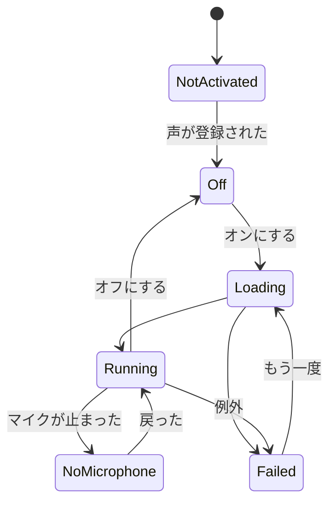

# Voice詳細設計

## 1. 目的

Voice Moduleは、マイクの声を登録済みの声へリアルタイムに変換する。配信中はPythonを使わず、Unityの中で完結する（方式設計9.1、9.5）。

試作の測定と経緯は[決定記録](../decisions/voice-conversion.md)にある。本書は製品としての形を定める。

この設計に含めないもの：声を作ること（[Voice Lab詳細設計](voice-lab.md)）、仮想マイク（方式設計9.4）、変換後のEQなどの後処理（方式設計9.9、後の段階）。

## 2. 責務

| 責務 | 担当 |
|---|---|
| マイクの取り込み、混ぜ合わせ、モニター、配信用のバス | Audio |
| 処理の段の出し入れ（`IAudioStage`） | Audio |
| ブロックの受け渡し、変換のオンとオフ、失敗時の扱い | Voice（`VoiceService`） |
| 変換の処理（DSP、モデルの実行） | Voice（`RvcVoiceConverter`） |
| 登録済みの声の一覧、検証、読み込み | Voice（`VoiceModelLibrary`） |
| 声の選択、音の高さ、失敗時の扱いの保存 | ProjectData（Voice Profile） |
| 声の作成と登録 | VoiceLab |
| 声の選択と状態の表示 | UI |

## 3. Moduleの境界

- `VirtualVessel.Voice`は`VirtualVessel.Audio`の`IAudioStage`だけを使う。ネイティブの音声プラグインを直接呼ばない。
- UIは`IVoiceConversion`（UIに置くInterface）だけを見る。RVC、モデル、Inference Engineの型はUIへ出さない。
- Inference Engineの型は`RvcVoiceConverter`の中に閉じる（方式設計9.12）。上位は`IVoiceConverter`だけを見る（方式設計9.6）。
- Voice Labが壊れていても、登録済みの声は動く（方式設計13.23）。VoiceはVoiceLabもExternalServicesも参照しない。

## 4. 主なClassとInterface

| Class | 種類 | 役割 |
|---|---|---|
| `IVoiceConversion` | Interface（UI） | 状態、選んだ声、音の高さ、オンとオフ |
| `VoiceService` | Class | Application Service：フレームごとにブロックを進める |
| `IVoiceConverter` | Interface | 変換方式の抽象（方式設計9.6） |
| `RvcVoiceConverter` | Class | RVC v2の実装。試作の`RvcStream` |
| `RvcDsp` | Static Class | リサンプル、メル、F0、クロスフェード。副作用なし |
| `VoiceModelLibrary` | Class | `VoiceModels`の一覧、検証、読み込み |
| `VoiceModelManifest` | Class | `voice.json`の内容 |
| `VoiceActivation` | Class | アクティベーションの状態を読む |

## 5. 公開API

方式設計9.6の`Process()`は同期の形だが、GPUの処理はメインスレッドからしか発行できず、完了を待つとフレームが止まる。そのため発行と回収を分ける。

```csharp
public interface IVoiceConverter : IDisposable
{
    int BlockSamples { get; }                // 48 kHz、モノラル
    TimeSpan AlgorithmDelay { get; }         // ブロックと処理の時間を除く遅れ
    bool IsBusy { get; }
    void Start(ReadOnlySpan<float> input);   // ブロックをGPUへ送る。メインスレッド
    bool Advance(Span<float> output);        // 進める。出力ができたらtrue。待たない
    void Reset();                            // つなぎ目の状態を捨てる
    VoiceTimings Timings { get; }            // 方式設計9.10の段階ごとの時間
}

public interface IVoiceConversion
{
    IReadOnlyObservable<VoiceConversionState> State { get; }
    IReadOnlyObservable<IReadOnlyList<VoiceModelInfo>> Models { get; }
    IReadOnlyObservable<VoiceOptions> Options { get; }  // 声、音の高さ、失敗時の扱い
    void SetOptions(VoiceOptions options);
    void SetEnabled(bool enabled);
}
```

## 6. Data Model

### 6.1 登録済みの声

`VoiceModels/<VoiceModelId>/`に置く。学習の成果物とは別物である（方式設計9.7、13.21）。

```text
VoiceModels/
├─ <VoiceModelId>/
│  ├─ voice.json        名前、推奨の音の高さ、形式の版、由来、ハッシュ
│  ├─ generator.sentis  学習した重みを書き込んだ生成器
│  └─ speaker.spk       話者ベクトル（256個のfloat）
└─ Shared/<版>/
   ├─ hubert.sentis
   └─ rmvpe.sentis
```

`voice.json`は`schemaVersion`を持つ（CLAUDE.md 25章）。`shape`に窓とブロックの値を持ち、Runtimeが対応しない形の声は「この版では使えません」と表示して、消さずに残す。

HuBERTとRMVPEは声によらず共通なので、1組だけ持つ。

### 6.2 Voice Profile

Projectの設定（方式設計6.3）。

| 項目 | 意味 |
|---|---|
| `schemaVersion` | 形式の版 |
| `voiceModelId` | 選んだ声。無いときは未選択 |
| `semitones` | 音の高さ。-24から24 |
| `onFailure` | `Mute`または`PassThrough`。既定は`Mute`（12章） |

声が見つからないときも設定は消さない（CLAUDE.md 25章）。

## 7. 状態とライフサイクル



- オフの間は毎フレームの処理を登録しない。使わない人に負荷をかけない。
- 登録された声があれば、Voice Labの環境が無くても使える。`NotActivated`は「声がなく、作る準備もしていない」状態である。

## 8. 主な流れ

### 8.1 1ブロック

```text
マイク → Audio → IAudioStage.Read → 貯める（100 ms）
  → Start：16 kHzへ、メル、HuBERTとRMVPEをGPUへ
  → Advance：完了したものから読む。読み出しは完了したフレームでしか読めない
  → 生成器をGPUへ
  → Advance：読む、48 kHzへ、クロスフェード
  → IAudioStage.Write → 混ぜ合わせ
```

### 8.2 声の切り替え

方式設計9.8のとおり、音声の機器は止めない。新しい声を裏で読み込み、準備運転が終わってから次のブロックで差し替える。切り替えの間は前の声が動き続ける。

### 8.3 映像との同期

変換の遅れの分、配信の映像を遅らせる（Audio詳細設計8.3、8.4）。`IAudioStage`に遅れの量を申告する口を足す。試作にはまだない。

## 9. Threadと非同期

- `Start`と`Advance`はメインスレッドで、`IFrameLoop`から呼ぶ。Inference EngineのGPU処理の制約である。
- モデルのファイルの読み込みはThread Poolで行い、`Worker`の作成と準備運転はメインスレッドで行う。
- 音声のスレッドとの受け渡しはAudioのリングバッファーで行い、混ぜ合わせを止めない。
- 測定：発行するフレームは13から17 ms、それ以外は0.1 ms。発行の負担を減らすことが課題である（15章）。

## 10. 設定

Voice Profileと、Developer Modeの次の値。固定の値は`voice.json`の`shape`による。

| 値 | 既定 | 意味 |
|---|---|---|
| ブロック | 100 ms | 短いほど遅延は減るが、処理が間に合わない |
| 窓 | 1秒 | HuBERTと生成器が見る長さ |
| クロスフェード | 20 ms | |
| 末尾の余白 | 30 ms | 減らすと遅延は減り、つなぎ目の揺れは増える |

ブロックと窓を変えるには、ひな形（Voice Lab詳細設計8.4）から作り直す必要がある。

## 11. 保存

6章のとおり。`VoiceModels`はData Rootにある。Avatarと同じく、利用者のAssetとして扱う。

アクティベーションの状態はVoice Labが書き、Voiceは読むだけである。

## 12. エラーと回復

| 起きたこと | 動作 | 利用者への表示 |
|---|---|---|
| 推論の例外 | 失敗時の扱いに従う | 音声変換を続けられませんでした |
| 声の読み込みの失敗 | オフのまま | この声を読み込めませんでした |
| マイクが止まった | 待つ | マイクの音が届いていません |
| 処理が遅れた | 古いブロックを捨てる | 表示しない。診断に数える |
| 声のハッシュが違う | 読み込まない | 声のファイルが壊れています |

**失敗時の既定は`Mute`とする。** 方式設計9.13は利用者の設定としている。声を変えて配信している人にとって、地声が流れることは取り返しがつかないので、既定では流さない。実装は、処理の段を入れたまま何も書かなければ無音になる。

## 13. ログと診断

- 状態の変化、読み込んだ声のID、形式の版、Backendを記録する。
- 毎ブロックのログは出さない（CLAUDE.md 20章）。段階ごとの時間は`IPerformanceMetrics`へ集計して渡す。
- 音声の内容は記録しない。
- 診断画面に、9.15の項目を表示する。

## 14. Testの方針

| 種類 | 内容 |
|---|---|
| EditMode | `RvcDsp`、`voice.json`の読み書きと古い形式、ライブラリの検証、状態の変化 |
| PlayMode | 本物のモデルでの実時間のベンチマーク。読み出しの非同期はPlayModeでしか確かめられない |
| ネイティブ | 処理の段のバースト、オンとオフ |
| 手動 | 実際のマイクで聞く |

モデルが無いCIでは、ベンチマークはIgnoreになる。

## 15. 性能

| 指標 | 基準 | 測定（RTX 4070、Editor） |
|---|---|---|
| 入力から出力まで | 200 ms（方式設計15.4） | **約270 ms、満たしていない** |
| 1ブロックの処理 | ブロックより短い | 85 ms |
| 発行するフレームの負担 | 下げる | 13から17 ms |
| 取りこぼし | 0 | 199ブロックで0 |

遅延を下げる順番：

1. 末尾の余白とバーストの余裕を、聞いて確かめながら減らす
2. ブロックを重ねて走らせ、ブロックを50 msにする
3. RMVPEの展開したGRUの発行を減らす。層が多く、発行の時間の半分を占める

## 16. Folder / Namespace

```text
Assets/VirtualVessel/Voice/
├─ Runtime/
│  ├─ VoiceService.cs
│  ├─ Conversion/   IVoiceConverter、RvcVoiceConverter、RvcDsp
│  └─ Models/       VoiceModelLibrary、VoiceModelManifest
├─ Editor/          VoiceModelImport（開発者がひな形を作る）
└─ Tests/
   ├─ EditMode/
   └─ Performance/  PlayModeで動く
```

`VirtualVessel.Voice`のasmdefは`VirtualVessel.Audio`、`VirtualVessel.Core`、`VirtualVessel.Diagnostics`、`VirtualVessel.ProjectData`、`VirtualVessel.UI`、`Unity.InferenceEngine`を参照する。

## 17. 段階と未解決

段階：

1. 試作を製品の形へ：`IVoiceConverter`、声のフォルダー、Voice Profile、設定画面
2. 映像との同期（8.3）
3. 遅延の改善（15章）
4. 後処理（方式設計9.9）

未解決：

- マイクとミキサーのクロックのずれの補正。試作では補正していない。ブロック単位で数サンプルを足し引きする案がある。
- GPUが遅いPCの扱い。必要な性能の基準がまだない。測定できたのはRTX 4070だけである。
- 配信の映像と同時に動かしたときのGPUの競合は、測定していない。
