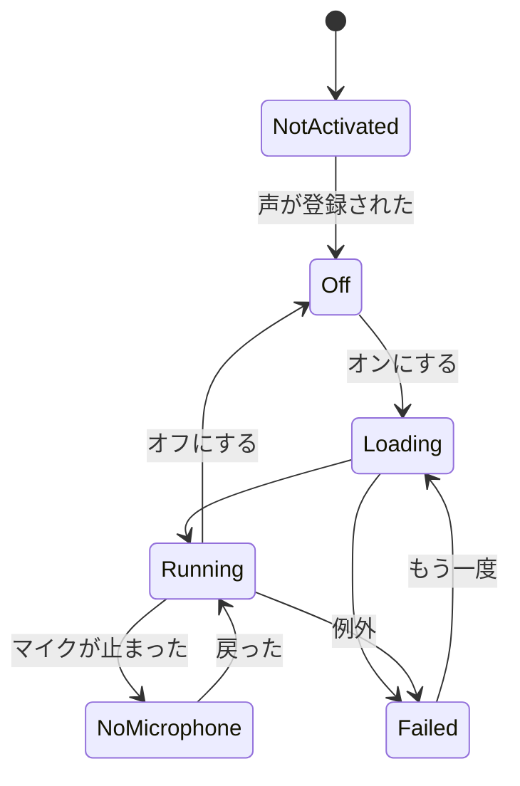

# Voice詳細設計

## 1. 目的

Voice Moduleは、マイクの声を登録済みの声へリアルタイムに変換する。配信中はPythonを使わず、Unityの中で完結する（方式設計9.1、9.5）。

試作の測定と経緯は[決定記録](../decisions/voice-conversion.md)にある。本書は製品としての形を定める。

この設計に含めないもの：声を作ること（[Voice Lab詳細設計](voice-lab.md)）、仮想マイク（方式設計9.4）、変換後のEQなどの後処理（方式設計9.9、後の段階）。

## 2. 責務

| 責務 | 担当 |
|---|---|
| マイクの取り込み、混ぜ合わせ、モニター、配信用のバス | Audio |
| 処理の段の出し入れ（`IAudioStage`） | Audio |
| ブロックの受け渡し、変換のオンとオフ、失敗時の扱い | Voice（`VoiceService`） |
| 変換の処理（DSP、モデルの実行） | Voice（`RvcVoiceConverter`） |
| 登録済みの声の記録（追加、一覧、名前の変更、削除） | Voice（`IVoiceModelRepository`） |
| 登録済みの声の検証、読み込み | Voice（`VoiceModelLibrary`） |
| 声の選択、音の高さ、失敗時の扱いの保存 | ProjectData（Voice Profile） |
| 声の作成、登録する声を渡すこと | VoiceLab |
| 声の選択と状態の表示 | UI |

## 3. Moduleの境界

- `VirtualVessel.Voice`は`VirtualVessel.Audio`の`IAudioStage`だけを使う。ネイティブの音声プラグインを直接呼ばない。
- UIは`IVoiceConversion`（UIに置くInterface）だけを見る。RVC、モデル、Inference Engineの型はUIへ出さない。
- Inference Engineの型は`RvcVoiceConverter`の中に閉じる（方式設計9.12）。上位は`IVoiceConverter`だけを見る（方式設計9.6）。
- Voice Labが壊れていても、登録済みの声は動く（方式設計13.23）。VoiceはVoiceLabもExternalServicesも参照しない。
- 登録済みの声はVoiceが持つ。VoiceLabは作った声を`IVoiceModelRepository.Add`で渡し、名前の変更と削除もこれを通す。参照はVoiceLabからVoiceへの一方向である（利用者の決定、2026-11-08）。

## 4. 主なClassとInterface

| Class | 種類 | 役割 |
|---|---|---|
| `IVoiceConversion` | Interface（UI） | 状態、選んだ声、音の高さ、オンとオフ |
| `VoiceService` | Class | Application Service：フレームごとにブロックを進め、どの声を使うかを決める |
| `VoiceLoader` | Class | 声のモデルをThread Poolで読み、`RvcStream`をメインスレッドで作る。HuBERTとRMVPEは使い回す（8.2） |
| `VoiceWarmup` | Class | 次の声の下ごしらえと準備運転。差し替えてよいかを決める（8.2） |
| `IVoiceConverter` | Interface | 変換方式の抽象（方式設計9.6） |
| `RvcVoiceConverter` | Class | RVC v2の実装。試作の`RvcStream` |
| `RvcDsp` | Static Class | リサンプル、メル、F0、クロスフェード。副作用なし |
| `IVoiceModelRepository` | Interface | 登録済みの声の記録：追加（ファイルを写す）、取得、一覧、名前の変更、削除。CRUDは方式設計6.31に従う |
| `VoiceModelStore` | Class | その最初の実装。声ごとの`model.json` |
| `VoiceModelLibrary` | Class | `VoiceModels`の検証、読み込み |
| `VoiceModelManifest` | Class | `voice.json`の内容 |
| `VoiceActivation` | Class | アクティベーションの状態を読む |

## 5. 公開API

方式設計9.6の`Process()`は同期の形だが、GPUの処理はメインスレッドからしか発行できず、完了を待つとフレームが止まる。そのため発行と回収を分ける。

```csharp
public interface IVoiceConverter : IDisposable
{
    int BlockSamples { get; }                // 48 kHz、モノラル
    TimeSpan AlgorithmDelay { get; }         // ブロックと処理の時間を除く遅れ
    bool IsBusy { get; }
    void Start(ReadOnlySpan<float> input);   // ブロックをGPUへ送る。メインスレッド
    bool Advance(Span<float> output);        // 進める。出力ができたらtrue。待たない
    void Reset();                            // つなぎ目の状態を捨てる
    VoiceTimings Timings { get; }            // 方式設計9.10の段階ごとの時間
}

public interface IVoiceConversion
{
    IReadOnlyObservable<VoiceConversionState> State { get; }
    CrudResult<IReadOnlyList<VoiceConversionVoice>> ListVoices();  // ID、名前、高さの中央値、使えるか
    string VoiceId { get; }                  // 選んだ声。試作の声は空文字
    void SelectVoice(string voiceId);        // 変換中なら裏で読み込んで差し替える（8.2）
    bool IsSwitching { get; }                // 選んだ声を準備している間
    float Semitones { get; set; }            // 利用者の調整。自動がオンなら自動の量に足す
    bool AutoPitch { get; set; }             // 高さの自動合わせ（8.4）。既定はオン
    float AutoSemitones { get; }             // 自動の量
    float UserPitchHz { get; }               // 測った利用者の高さの中央値。測るまでは0
    float VoicePitchHz { get; }              // 声の高さの中央値。分からないときは0
    void RemeasurePitch();                   // 測り直す
    void SetEnabled(bool enabled);
}
```

- 一覧はディスクを読むので、画面を開いたときに読む（方式設計6.31）。使えない声（6.1）も一覧に出し、選べないことを示す。
- 声を選んでいないときは、一覧の最初の使える声を使う。試作の声があれば、それが最初である。
- 音の高さと失敗時の扱いは、Voice Profile（6.2）と一緒に足す。

## 6. Data Model

### 6.1 登録済みの声

`VoiceModels/<VoiceModelId>/`に置く。学習の成果物とは別物である（方式設計9.7、13.21）。

```text
VoiceModels/
├─ voice-<RunId>/
│  ├─ model.json    名前、元のRun、登録の日時、声の高さの中央値、版。VoiceModelStoreだけが読み書きする
│  ├─ voice.json    形式の版、窓と返すフレームの数、声の高さの中央値
│  ├─ voice.sentis  学習した重みを書き込んだ生成器
│  ├─ voice.spk     話者ベクトル（256個のfloat）
│  └─ design.json   作り方。Voice Labのファイルで、Voiceは読まずに写す
├─ Shared/1/
│  ├─ hubert_16000_anchored.sentis
│  └─ rmvpe_32.sentis
└─ Prototype/        開発者が置いた試作の声と共通のモデル
```

- 追加では、隣のフォルダー（`.part`）へ写してから名前を変える。配信の側が作りかけの声を読むことはない。`voice.sentis`、`voice.spk`、`voice.json`のどれかがなければ断る（`Invalid`）。
- `model.json`の、この版が知らない項目は消さずに書き戻す（CLAUDE.md 25章）。2026-11-08より前の声は、ここにVoice Labの`design`を持っていた。

`voice.json`は`schemaVersion`を持つ（CLAUDE.md 25章）。`frames`と`returned`に窓と返すフレームの数を持ち、Runtimeが対応しない形の声は「この版では使えません」と表示して、消さずに残す。

HuBERTとRMVPEは声によらず共通なので、1組だけ持つ。`Shared/1/`の`1`は書き出しの版で、生成器の形と直前の声（SpeechAnchor）に対になる。そこになければ`Prototype/`のものを使う。アクティベーション（Voice Lab詳細設計8.1）ができるまでは、`Prototype/`にしかない。

`Prototype/`の声（`fused_w100.sentis`と`.spk`）は記録を持たず、一覧では「試作の声」として出る。開発中に、登録した声と比べるためのものである。

### 6.2 Voice Profile

Projectの設定（方式設計6.3）。

| 項目 | 意味 |
|---|---|
| `schemaVersion` | 形式の版 |
| `voiceModelId` | 選んだ声。無いときは未選択 |
| `semitones` | 音の高さ。-24から24 |
| `onFailure` | `Mute`または`PassThrough`。既定は`Mute`（12章） |

声が見つからないときも設定は消さない（CLAUDE.md 25章）。

### 6.3 PCごとの設定（設計中）

GPUの負担はPCによって違うので、次はProjectでなくPCごとに持つ（利用者の決定、2026-11-03）。設定のフォルダーの`Config/voice-settings.json`に置く。`app-settings.json`（使うProjectを記録する、ProjectDataのファイル）には入れない。`ui-settings.json`と同じく、Moduleごとのファイルにする。

| 項目 | 意味 |
|---|---|
| `schemaVersion` | 形式の版 |
| `denoise` | ノイズ除去 |
| `monitorVoice` | 自分に聞こえる声。`Converted`、`Original`（セットアップ画面13.3） |

窓は1秒、つなぎ目の重ねは50 msに固定し、設定にしない（利用者の決定、2026-11-03）。

## 7. 状態とライフサイクル



- オフの間は毎フレームの処理を登録しない。使わない人に負荷をかけない。
- 登録された声があれば、Voice Labの環境が無くても使える。`NotActivated`は「声がなく、作る準備もしていない」状態である。

## 8. 主な流れ

### 8.1 1ブロック

```text
マイク → Audio → IAudioStage.Read → 貯める（100 ms）
  → Start：ノイズ除去（RNNoise。声のある間は元の音を戻す）、16 kHzへ、メル、HuBERT（窓の前に利用者の直近の話し声1秒）とRMVPEをGPUへ
  → Advance：完了したものから読む。読み出しは完了したフレームでしか読めない
  → 生成器をGPUへ
  → Advance：読む、48 kHzへ、クロスフェード
  → IAudioStage.Write → 混ぜ合わせ
```

### 8.2 声の切り替え

方式設計9.8のとおり、音声の機器は止めない。新しい声を裏で読み込み、準備運転が終わってから次のブロックで差し替える。切り替えの間は前の声が動き続ける。

```text
選ぶ → 生成器と話者ベクトルをThread Poolで読む（HuBERTとRMVPEは読み込み済みのものを使う）
  → RvcStreamを作る（メインスレッド、約40 ms）
  → 下ごしらえ：各モデルを1層ずつ無音で実行する。1フレームに4 msまで
  → 準備運転：無音のブロックを3つ、ふつうのブロックと同じく待たずに進める
  → 前の声が手元のブロックを終えたら差し替え、前の声を捨てる
```

- 新しいWorkerの最初の実行は、すべての層を準備するので、1回で約300 msかかる（RTX 4070）。そのままではそのフレームが止まり、前の声のブロックが9つ捨てられた。`Worker.ScheduleIterable`で層ごとに分け、1フレームの時間に上限を置いた。
- 準備の間に別の声を選び直すと、準備したものは使わずに捨て、選び直した声を読む。
- 読み込めなかったときは、前の声のまま変換を続け、ログに残す。
- オフの間に選んだ声は、次にオンにしたときに読む。

### 8.3 映像との同期

変換の遅れの分、配信の映像を遅らせる（Audio詳細設計8.3、8.4）。`IAudioStage`に遅れの量を申告する口を足す。試作にはまだない。

### 8.4 高さの自動合わせ

声は、その声の高さで鳴らないと、声色が合っていても別の声に聞こえる（決定記録、2026-11-08）。そこで、利用者の声の高さの中央値を声の高さの中央値へ移す（Voice Lab詳細設計8.3.4）。

```text
半音 = 12・log2(声の中央値 / 利用者の中央値)  を整数に丸め、±24に収める
かける量 = （自動がオンなら）半音 + 利用者の調整
```

- 声の中央値は、登録の記録（`model.json`の`medianPitchHz`）から読む。分からない声（試作の声）では合わせない。
- 利用者の高さは、変換の中のRMVPEの高さを使う。別の推定はしない。生成器の`f0new`（半音を移す前の高さ）のうち、反射の補いに頼らない、確定した1ブロック分の10フレームを毎ブロック集める（`PitchMeter`）。マイクでも録音でも同じである。
- 生成器は、声のないフレームを直前の声の高さで埋めて返す。これを数えると、文の終わりの下がった高さに中央値が引かれた（149 Hz。上流のRMVPEでは200 Hz）。埋めたフレームは直前とまったく同じ値になり、声のフレームは区間の重み付き平均なので同じ値が続かない。そこで、直前と同じ値のフレームは数えない。直すと、上流のRMVPEと同じ200 Hzになった。
- 声のある時間が2秒たまったら合わせ始め、10秒たまったら値を保つ。後で高い音で歌っても、移す量は動かない。「測り直す」で最初から測る。
- 合わせ始めるまでの約2秒は、利用者の高さのまま鳴る。測った値をPCごとの設定（6.3）に残せば、次からは最初から合う。設定と一緒に作る。
- 集める処理はブロックごとに動くので、バッファーを使い回し、ゴミを作らない。中央値の並べ替えは、測っている間（最初の10秒）だけである。

## 9. Threadと非同期

- `Start`と`Advance`はメインスレッドで、`IFrameLoop`から呼ぶ。Inference EngineのGPU処理の制約である。
- モデルのファイルの読み込みはThread Poolで行い、`Worker`の作成と準備運転はメインスレッドで行う。
- 音声のスレッドとの受け渡しはAudioのリングバッファーで行い、混ぜ合わせを止めない。
- 測定：発行するフレームは13から17 ms、それ以外は0.1 ms。発行の負担を減らすことが課題である（15章）。

## 10. 設定

Voice Profileと、Developer Modeの次の値。固定の値は`voice.json`の`shape`による。

| 値 | 既定 | 意味 |
|---|---|---|
| ブロック | 100 ms | 短いほど遅延は減るが、処理が間に合わない |
| 窓 | 1秒（固定） | HuBERTと生成器が見る長さ。窓の前に利用者の話し声を置いてからは、2.5秒と5.4秒を聞いても違いが分からなかった。長いほどGPUを多く使う（決定記録、2026-11-03） |
| クロスフェード | 50 ms | 20 msでは、ブロックごとのつなぎ目で音が変わり、持続音の揺れとして聞こえた（決定記録、2026-11-03） |
| 末尾の余白 | 30 ms | 減らすと遅延は減り、つなぎ目の揺れは増える（決定記録） |

ブロックと窓を変えるには、ひな形（Voice Lab詳細設計8.4）から作り直す必要がある。

## 11. 保存

6章のとおり。`VoiceModels`はData Rootにある。Avatarと同じく、利用者のAssetとして扱う。

アクティベーションの状態はVoice Labが書き、Voiceは読むだけである。

## 12. エラーと回復

| 起きたこと | 動作 | 利用者への表示 |
|---|---|---|
| 推論の例外 | 失敗時の扱いに従う | 音声変換を続けられませんでした |
| 声の読み込みの失敗 | オフのまま | この声を読み込めませんでした |
| マイクが止まった | 待つ | マイクの音が届いていません |
| 処理が遅れた | 古いブロックを捨てる | 表示しない。診断に数える |
| 声のハッシュが違う | 読み込まない | 声のファイルが壊れています |

**失敗時の既定は`Mute`とする（利用者の承認、2026-11-01）。** 方式設計9.13は利用者の設定としている。声を変えて配信している人にとって、地声が流れることは取り返しがつかないので、既定では流さない。実装は、処理の段を入れたまま何も書かなければ無音になる。

## 13. ログと診断

- 状態の変化、読み込んだ声のID、形式の版、Backendを記録する。
- 毎ブロックのログは出さない（CLAUDE.md 20章）。段階ごとの時間は`IPerformanceMetrics`へ集計して渡す。
- 音声の内容は記録しない。
- 診断画面に、9.15の項目を表示する。

## 14. Testの方針

| 種類 | 内容 |
|---|---|
| EditMode | `RvcDsp`、`voice.json`の読み書きと古い形式、ライブラリの検証（共通のモデルの場所、形の合わない声）、差し替えの条件、状態の変化 |
| PlayMode | 本物のモデルでの実時間のベンチマークと、変換中の声の切り替え（`VV_VOICE_MODELS`に登録した声のフォルダー）。読み出しの非同期はPlayModeでしか確かめられない |
| ネイティブ | 処理の段のバースト、オンとオフ |
| 手動 | 実際のマイクで聞く |

モデルが無いCIでは、ベンチマークはIgnoreになる。

## 15. 性能

| 指標 | 基準 | 測定（RTX 4070、Editor） |
|---|---|---|
| 入力から出力まで | 200 ms（方式設計15.4） | **約270 ms、満たしていない** |
| 1ブロックの処理 | ブロックより短い | 87 ms |
| 発行するフレームの負担 | 下げる | 13から17 ms |
| 取りこぼし | 0 | 199ブロックで0 |
| 声の切り替え | 取りこぼしなし | 159ブロックで0。選んでから約1.5秒で替わる。その間のフレームは中央値4.7 ms、最長47 ms（RvcStreamを作るフレーム） |

遅延を下げる順番：

1. 末尾の余白とバーストの余裕を、聞いて確かめながら減らす。余白10 msは効果が小さく、持続音が揺れたので見送った
2. 1ブロックの仕事を窓の長さに比例させない（HuBERTの過去の出力を使い回すなど）。そのあとでブロックを50 msにできる。ブロックを重ねて走らせるだけでは、GPUが間に合わなかった（決定記録）
3. RMVPEの展開したGRUの発行を減らす。層が多く、発行の時間の半分を占める

## 16. Folder / Namespace

```text
Assets/VirtualVessel/Voice/
├─ Runtime/
│  ├─ VoiceService.cs
│  ├─ VoiceLoader.cs、VoiceWarmup.cs
│  ├─ Conversion/   IVoiceConverter、RvcVoiceConverter、RvcDsp
│  └─ Models/       IVoiceModelRepository、VoiceModelStore、VoiceModelLibrary、VoiceModelManifest
├─ Editor/          VoiceModelImport（開発者がひな形を作る）
└─ Tests/
   ├─ EditMode/
   └─ Performance/  PlayModeで動く
```

`VirtualVessel.Voice`のasmdefは`VirtualVessel.Audio`、`VirtualVessel.Core`、`VirtualVessel.Diagnostics`、`VirtualVessel.ProjectData`、`VirtualVessel.UI`、`Unity.InferenceEngine`を参照する。

## 17. 段階と未解決

段階：

1. 試作を製品の形へ：`IVoiceConverter`、声のフォルダー、Voice Profile、設定画面
2. 映像との同期（8.3）
3. 遅延の改善（15章）
4. 後処理（方式設計9.9）

未解決：

- マイクとミキサーのクロックのずれの補正。試作では補正していない。ブロック単位で数サンプルを足し引きする案がある。
- 設定の見せ方（利用者の要望、2026-11-03）。普段は簡単に使え、窓などの詳細な設定も残す。何を優先するかで選ぶ設定（GPUを軽く、なめらかさ）は、窓1秒が音でもGPUでも一番よかったので置かない（利用者の決定、2026-11-03）。「歌唱」のような用途の名前は付けない。歌への期待や権利の話を呼び込みやすいためである。自分の耳に返す音（変換後の声、元の声、返さない）は別の設定にする。変換後の声は0.38秒遅れるので、歌うときはリズムを取りにくい。画面の設計はセットアップ画面13章（画面案は利用者の確認待ち）。
- GPUが遅いPCの扱い。使えるGPUがないときだけ、声の変換をオンにできないようにする（利用者の決定、2026-11-03。セットアップ画面13.4）。どのGPUから使えるかの基準は置かない。必要な性能の基準がまだない。測定できたのはRTX 4070だけである。
- 配信の映像と同時に動かしたときのGPUの競合は、測定していない。
